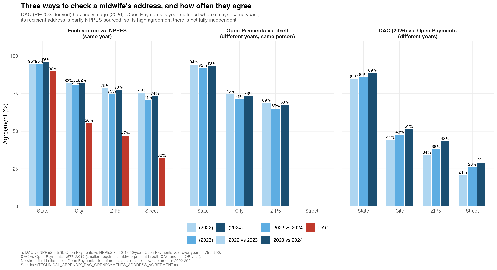

# Technical Appendix: DAC and Open Payments Against NPPES's Self-Reported Address

**Repository**: `midwifery`
**Primary scripts**: [`extract_dac_midwives.R`](../extract_dac_midwives.R), [`match_open_payments_general_payments.py`](../match_open_payments_general_payments.py), [`compare_dac_openpayments_to_nppes_address.R`](../compare_dac_openpayments_to_nppes_address.R), [`make_address_agreement_figure.R`](../make_address_agreement_figure.R)
**Related**: [`TECHNICAL_APPENDIX_MIGRATION_YEAR_OVER_YEAR.md`](TECHNICAL_APPENDIX_MIGRATION_YEAR_OVER_YEAR.md) (the question this was raised to help answer — can an NPPES-measured move be independently confirmed), [`OPEN_PAYMENTS_LINKAGE_COMPARISON.md`](OPEN_PAYMENTS_LINKAGE_COMPARISON.md) (two prior, disagreeing Open Payments employer-linkage builds — a different question from this one)
**Investigation date**: 2026-10-20 to 2026-10-21
**Status**: measurement complete; interpretation of the DAC-vs-Open-Payments gap is open.

---

## 1. Why this exists

NPPES's self-reported practice address is the backbone of every geography
result in this repository, including the year-by-year migration measurement
in `TECHNICAL_APPENDIX_MIGRATION_YEAR_OVER_YEAR.md`. That appendix found two
anomalous mobility spikes correlated with NPPES file-format changes and
explicitly asked for a source NPPES doesn't control to check against. This
appendix is that check, run for real against two sources already present in
this project: CMS Doctors & Clinicians (DAC, PECOS-derived) and CMS Open
Payments (Sunshine Act general payments).

Three questions, not one:

1. **Does DAC agree with NPPES, for the same provider, in the same year?**
2. **Does Open Payments agree with NPPES, for the same provider, in the same
   year?**
3. **Do DAC and Open Payments agree with *each other*, and does Open
   Payments agree with *itself* across different program years for the same
   person?**

## 2. What was pulled, and what it's dated to

- **DAC**: `data/CMS_DAC_NationalDownloadableFile.csv`, one vintage, dated
  2026-06. `extract_dac_midwives.R` filters to `pri_spec`/`sec_spec_all` LIKE
  `%MIDWIFE%` and collapses to one row per NPI: **5,680 distinct midwife
  NPIs**, each with `practice_address`, `practice_city`, `practice_state`,
  `practice_zip` — a full street address, independently sourced through
  Medicare enrollment (PECOS), not NPPES self-report.
- **Open Payments**: `match_open_payments_general_payments.py`, re-run this
  session for **program years 2022, 2023 and 2024** (previously this project
  had only pulled 2024). Each year is looked up live from CMS's own
  metastore catalog (`openpaymentsdata.cms.gov`) rather than a hardcoded
  download URL — the publication-date segment of the URL
  (`PGYR2024_P06302026_06032026`) is not predictable release to release, the
  same failure mode `archive_revalidation_reassignment.R` hit this month
  against a different CMS catalog. One row per matched midwife-year:
  `recipient_address`, `recipient_city`, `recipient_state`,
  `recipient_zip`. **A real bug was caught and fixed while doing this**: the
  script already parsed `Recipient_Primary_Business_Street_Address_Line1`
  from the raw file but silently dropped it before writing the output —
  street-level Open Payments comparison was impossible before this session
  for exactly that reason, not because the field doesn't exist.
  - Coverage: **3,342 / 3,556 / 4,042** of the 12,171-cohort midwives appear
    in Open Payments at all, for 2022 / 2023 / 2024 respectively — appearing
    requires having received a reportable industry payment that year, so
    this is a real but partial subset, not a universal check.
- **NPPES**: `midwife_panel.csv`, the same annual-snapshot panel the
  migration appendix uses. Each comparison below pulls the NPPES snapshot
  for **the same year the other source is dated to** — DAC (2026) against
  NPPES's 2026 snapshot, Open Payments 2022/2023/2024 against NPPES's
  2022/2023/2024 snapshots respectively. Comparing against *today's* address
  instead would conflate genuine disagreement with any move that happened
  in between.

## 3. Results

All agreement percentages are computed only over pairs where **both** sides
have a non-blank value at that geographic level (`comparable_n`); see
`artifacts/dac_openpayments_vs_nppes_address_agreement.csv` for the full
table with `comparable_n`/`agree_n` alongside every percentage.



### 3a. Each source vs. NPPES, same year (n = 5,576 DAC; 3,210–4,020/year Open Payments)

| Level | DAC (2026) | Open Payments 2022 | 2023 | 2024 |
|---|---:|---:|---:|---:|
| State | 89.8% | 94.8% | 94.8% | 95.8% |
| City | 55.6% | 81.9% | 80.7% | 82.2% |
| ZIP5 | 47.1% | 78.6% | 75.0% | 77.6% |
| Street | 32.2% | 75.4% | 70.7% | 73.5% |

### 3b. Open Payments against itself, different program years, same person (n = 2,175–2,500)

| Level | 2022 vs 2023 | 2022 vs 2024 | 2023 vs 2024 |
|---|---:|---:|---:|
| State | 94.4% | 92.3% | 93.2% |
| City | 74.9% | 71.2% | 73.4% |
| ZIP5 | 68.9% | 65.1% | 67.6% |

(No street row: `recipient_address` was only captured starting with this
session's fix, so year-over-year street continuity cannot yet be checked —
it will be computable the next time one of these years is re-pulled.)

### 3c. DAC (2026) vs. Open Payments directly, no NPPES in between (n = 1,577–2,019)

| Level | vs. 2022 | vs. 2023 | vs. 2024 |
|---|---:|---:|---:|
| State | 84.4% | 85.9% | 88.8% |
| City | 44.2% | 47.6% | 51.4% |
| ZIP5 | 34.1% | 38.1% | 43.4% |
| Street | 21.1% | 26.3% | 29.2% |

## 4. The finding that wasn't expected going in

Two independent sources agree with NPPES noticeably more than they agree
with **each other**. DAC vs. NPPES is 55.6% at the city level; DAC vs. Open
Payments is 44.2–51.4%, lower every year, despite Open Payments itself
agreeing with NPPES at 80–82% city-level. If DAC and Open Payments were each
simply "noisy around the truth," two independent noisy measurements of the
same thing should not agree with each other *less* than each agrees with a
third, also-independent measurement.

Three non-exclusive explanations, none confirmed here:

- **Open Payments' address field is partly NPPES-sourced for many covered
  recipients** (CMS populates it from NPPES at points in the recipient's
  provider-profile pipeline). If so, "Open Payments vs. NPPES" is partly
  comparing NPPES against a copy of itself, which would mechanically inflate
  that agreement rate without reflecting independent confirmation — and
  would simultaneously explain why DAC (genuinely independent, PECOS-derived)
  agrees with Open Payments only about as well as it agrees with NPPES
  directly, not better. This is the most likely explanation but **it has
  not been verified against CMS's own documentation of the Open Payments
  recipient-profile pipeline** — it is a hypothesis consistent with the
  pattern, not a confirmed mechanism.
- **The DAC-vs-Open-Payments comparison spans a real multi-year gap** (DAC
  is 2026, Open Payments is 2022–2024) that the "vs. NPPES" comparisons
  don't carry to the same degree, since each of those is same-year. Some of
  the DAC-vs-Open-Payments disagreement could be genuine moves in the
  intervening 2–4 years rather than source noise — consistent with §3c's
  own pattern of improving agreement as the Open Payments year gets closer
  to DAC's 2026 vintage (44.2% → 47.6% → 51.4% at the city level, 2022 →
  2023 → 2024).
- **DAC's PECOS-sourced address and a Medicare-unrelated commercial
  address (Open Payments) are simply two different kinds of record** —
  enrollment address versus a payment-reporting business address — that
  were never guaranteed to be the same building even for an accurately
  NPPES-reported person.

## 5. What this does and does not establish

- **It gives a real, measured answer to "how much do independent address
  sources disagree," at four geographic grains, for three different
  source-pairs** — useful context for interpreting any NPPES-based result,
  including the migration appendix's anomalous-year spikes: NPPES addresses
  disagree with a genuinely separate system (DAC) on *city* about as often
  as they agree, even outside any anomalous year.
- **It does not resolve the migration appendix's open question.** None of
  these three sources are multi-year with full address granularity for the
  same calendar years NPPES's anomalous transitions fall in (2017→2018,
  2023→2024) — Open Payments only goes back to 2013 in principle, but this
  project has only pulled 2022–2024 so far, and DAC has exactly one vintage.
  Closing that gap would mean pulling Open Payments 2017 and 2018
  specifically (the metastore catalog lookup this session built makes that
  a one-line change: `OPEN_PAYMENTS_YEAR=2017 python3 match_open_payments_general_payments.py`)
  and re-running `compare_dac_openpayments_to_nppes_address.R`.
- **The Open-Payments-vs-itself check (§3b) is the one genuinely
  same-source longitudinal address signal this project now has**, independent
  of NPPES. Its year-over-year disagreement (city: 25–29%) is higher than
  the within-year Open-Payments-vs-NPPES disagreement (city: 18–19%), which
  is the expected direction if some of it is real movement rather than pure
  source noise — but the two are not cleanly separable from this comparison
  alone.

## 6. Reproducing

```sh
# DAC (one vintage; set DAC_FILE if the national file lives somewhere else)
Rscript extract_dac_midwives.R

# Open Payments, one program year per run -- repeat for whichever years matter
OPEN_PAYMENTS_YEAR=2022 python3 match_open_payments_general_payments.py
OPEN_PAYMENTS_YEAR=2023 python3 match_open_payments_general_payments.py
OPEN_PAYMENTS_YEAR=2024 python3 match_open_payments_general_payments.py

# Comparison + figure (auto-discovers whichever Open Payments years exist in artifacts/)
Rscript compare_dac_openpayments_to_nppes_address.R
Rscript make_address_agreement_figure.R
```

Requires `midwife_panel.csv` (NPPES annual snapshots, gitignored,
person-level, ~455 MB) and a network connection for the DAC national file and
each Open Payments program-year pull (tens of millions of rows streamed and
filtered; each year takes several minutes).
