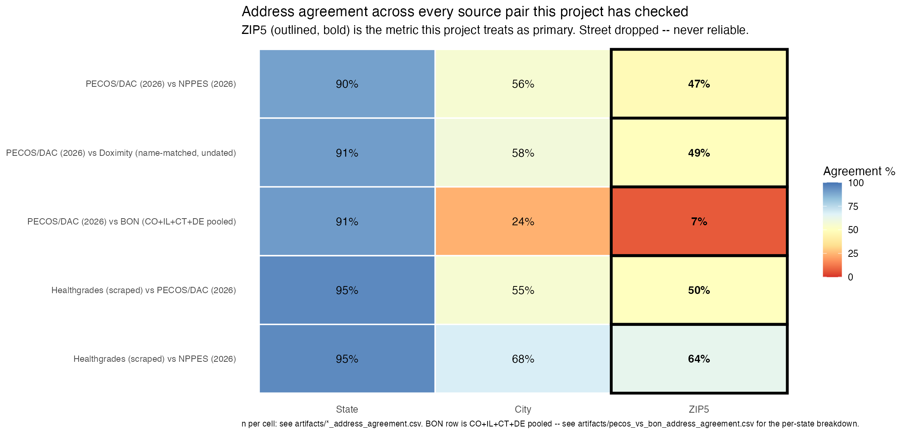
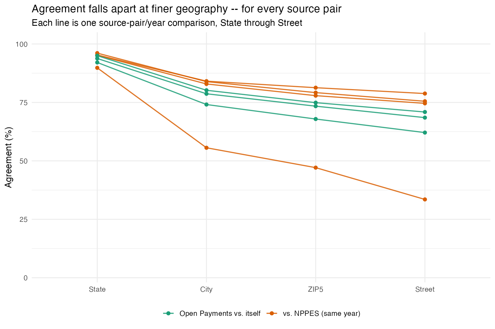
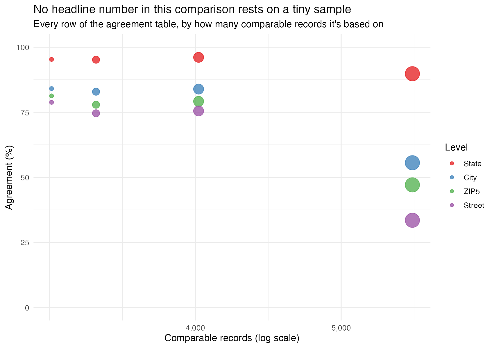
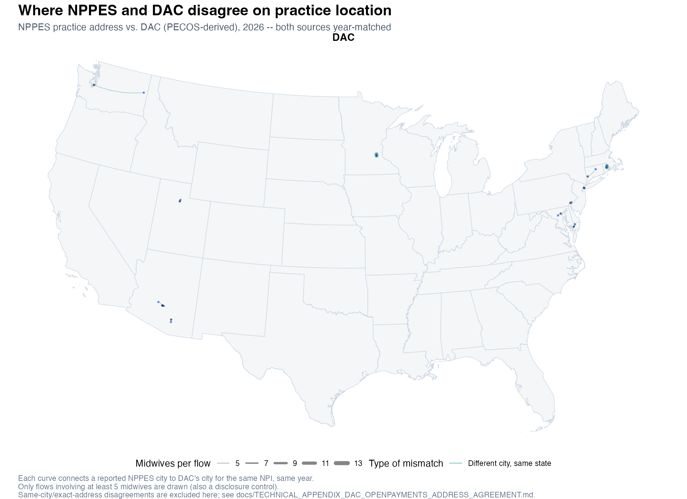
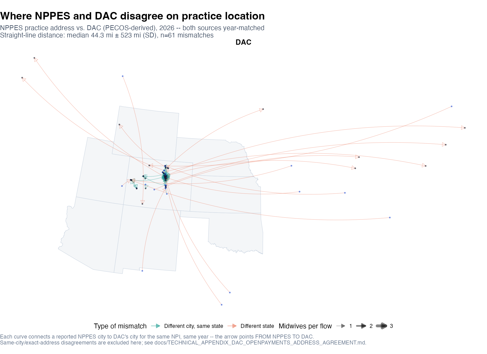
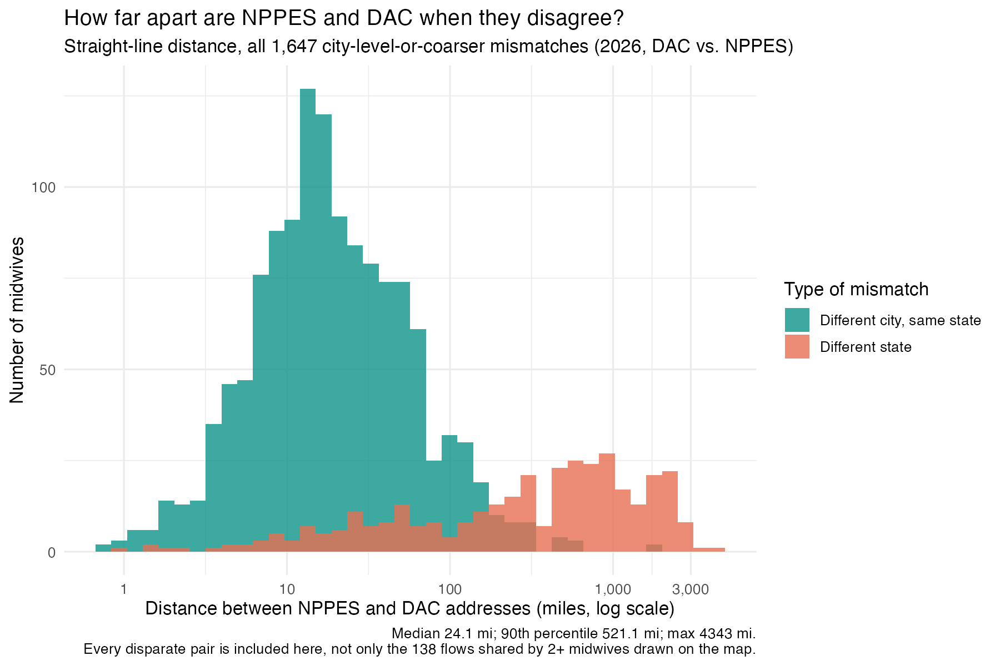

# Technical Appendix: DAC and Open Payments Against NPPES's Self-Reported Address

**Repository**: `midwifery`
**Primary scripts**: [`extract_dac_midwives.R`](../extract_dac_midwives.R), [`match_open_payments_general_payments.py`](../match_open_payments_general_payments.py), [`compare_dac_openpayments_to_nppes_address.R`](../compare_dac_openpayments_to_nppes_address.R), [`make_address_agreement_figure.R`](../make_address_agreement_figure.R), [`make_address_agreement_additional_figures.R`](../make_address_agreement_additional_figures.R), [`build_dac_nppes_address_flow_pairs.R`](../build_dac_nppes_address_flow_pairs.R), [`make_dac_nppes_address_flow_map.R`](../make_dac_nppes_address_flow_map.R)
**Related**: [`TECHNICAL_APPENDIX_MIGRATION_YEAR_OVER_YEAR.md`](TECHNICAL_APPENDIX_MIGRATION_YEAR_OVER_YEAR.md) (the question this was raised to help answer — can an NPPES-measured move be independently confirmed), [`OPEN_PAYMENTS_LINKAGE_COMPARISON.md`](OPEN_PAYMENTS_LINKAGE_COMPARISON.md) (two prior, disagreeing Open Payments employer-linkage builds — a different question from this one)
**Investigation date**: 2026-10-20 to 2026-10-22
**Status**: measurement complete. One comparison, every row of it year-matched: DAC or Open Payments against NPPES, same provider, same year. Two other comparisons were built and removed — see §4.

---

## 1. Why this exists

NPPES's self-reported practice address is the backbone of every geography
result in this repository, including the year-by-year migration measurement
in `TECHNICAL_APPENDIX_MIGRATION_YEAR_OVER_YEAR.md`. That appendix found two
anomalous mobility spikes correlated with NPPES file-format changes and
explicitly asked for a source NPPES doesn't control to check against. This
appendix is that check, run for real against two sources already present in
this project: CMS Doctors & Clinicians (DAC, PECOS-derived) and CMS Open
Payments (Sunshine Act general payments).

One question: **does DAC, or does Open Payments, agree with NPPES on a
midwife's practice address — for the same provider, in the same year?**

Two other questions were tried and abandoned, both for the same reason:
neither could be answered without comparing data from different years as if
they were the same year. See §4.

## 2. What was pulled, and what it's dated to

- **DAC**: `data/CMS_DAC_NationalDownloadableFile.csv`, one vintage, dated
  2026-06. `extract_dac_midwives.R` filters to `pri_spec`/`sec_spec_all` LIKE
  `%MIDWIFE%` and collapses to one row per NPI: **5,680 distinct midwife
  NPIs**, each with `practice_address`, `practice_city`, `practice_state`,
  `practice_zip` — a full street address, independently sourced through
  Medicare enrollment (PECOS), not NPPES self-report.
- **Open Payments**: `match_open_payments_general_payments.py`, re-run this
  session for **program years 2022, 2023 and 2024** (previously this project
  had only pulled 2024). Each year is looked up live from CMS's own
  metastore catalog (`openpaymentsdata.cms.gov`) rather than a hardcoded
  download URL — the publication-date segment of the URL
  (`PGYR2024_P06302026_06032026`) is not predictable release to release, the
  same failure mode `archive_revalidation_reassignment.R` hit this month
  against a different CMS catalog. One row per matched midwife-year:
  `recipient_address`, `recipient_city`, `recipient_state`,
  `recipient_zip`. **A real bug was caught and fixed while doing this**: the
  script already parsed `Recipient_Primary_Business_Street_Address_Line1`
  from the raw file but silently dropped it before writing the output —
  street-level Open Payments comparison was impossible before this session
  for exactly that reason, not because the field doesn't exist.
  - Coverage: **3,342 / 3,556 / 4,042** of the 12,171-cohort midwives appear
    in Open Payments at all, for 2022 / 2023 / 2024 respectively — appearing
    requires having received a reportable industry payment that year, so
    this is a real but partial subset, not a universal check.
  - **Open Payments is one row per payment *transaction*, not one row per
    recipient-year**: ~37% of matched midwives in the 2022 file (and
    similar shares in 2023/2024) have more than one reported address in the
    same program year — multiple employers or practice sites paying out
    that year. Picking a single representative address per NPI-year
    therefore needs a stated rule, not an arbitrary row. This repo's safe
    rule is: the `(state, city, zip, street)` combination reported on the
    **most transactions** that year, ties broken alphabetically for
    determinism (`collapse_to_modal_address()` in
    `compare_dac_openpayments_to_nppes_address.R`). The repo's live
    `distinct(.keep_all = TRUE)` drift ratchet
    (`tests/test_cycle40_keepall_sweep_scope.R`, T40-5) is what caught the
    original arbitrary-row version of this script and forced this fix.
- **NPPES**: `midwife_panel.csv`, the same annual-snapshot panel the
  migration appendix uses. Each comparison below pulls the NPPES snapshot
  for **the same year the other source is dated to** — DAC (2026) against
  NPPES's 2026 snapshot, Open Payments 2022/2023/2024 against NPPES's
  2022/2023/2024 snapshots respectively. Comparing against *today's* address
  instead would conflate genuine disagreement with any move that happened
  in between.

## 3. Results

All agreement percentages are computed only over pairs where **both** sides
have a non-blank value at that geographic level (`comparable_n`); see
`artifacts/dac_openpayments_vs_nppes_address_agreement.csv` for the full
table with `comparable_n`/`agree_n` alongside every percentage.


### Each source vs. NPPES, same year (n = 5,576 DAC; 3,210–4,020/year Open Payments)

| Level | DAC (2026) | Open Payments 2022 | 2023 | 2024 |
|---|---:|---:|---:|---:|
| State | 89.8% | 95.3% | 95.2% | 96.1% |
| City | 55.6% | 84.1% | 82.9% | 83.9% |
| ZIP5 | 47.1% | 81.3% | 77.9% | 79.2% |
| Street | 32.8% | 78.8% | 74.6% | 75.5% |

## 4. Two comparisons that were tried and removed

Two other comparisons lived in earlier versions of this appendix. Both are
gone as of 2026-10-22.

**DAC directly against Open Payments** (plus a three-way NPPES/DAC/Open-
Payments concordance figure built on top of it). DAC has exactly **one**
public vintage. Checked directly against CMS's own metastore API
(`data.cms.gov/provider-data/api/1/metastore/schemas/dataset/items/mj5m-pzi6`)
— it returns a single `distribution`, no history. Wayback Machine has only
captured the dataset's JS-rendered landing page, not the underlying
700+MB CSV. There is no public way to fetch "DAC as it stood in 2022" (or
2023, or 2024) the way Open Payments publishes one archived file per program
year. Any DAC-vs-Open-Payments comparison was therefore always DAC's single
2026 vintage against an Open Payments year 2–4 years earlier — a real,
unclosable gap, not a year match, no matter how clearly the gap was
labeled. (A personal 2021 DAC snapshot exists in the repo owner's iCloud
Drive, which would narrow the gap to one year for the 2022 Open Payments
pull only — not pursued, since it still wouldn't be a true match, and would
leave 2023/2024 with no DAC comparison at all.) What it had shown, for the
record: DAC agreed with Open Payments *less* than DAC agreed with NPPES
directly, despite Open Payments agreeing with NPPES far more than DAC
did — consistent with, though no longer offered as evidence for, the
NPPES-sourcing suspicion in §5.

**Open Payments against itself, different program years, same person.**
This one *was* genuinely year-matched in the sense that every comparison
pair was labeled with the two real years being compared — the problem the
other removed comparison had. It was removed anyway, at the repo owner's
request, so this appendix carries exactly one comparison type rather than
mixing same-source-across-years results in with same-year-across-sources
results.

"Every analysis needs to be year matched" is a hard rule in this project —
see git history for the removed figures, computations, and exact prior
numbers for both.

## 5. What this does and does not establish

- **DAC agrees with NPPES noticeably less than Open Payments does, and both
  comparisons are year-matched.** DAC vs. NPPES (2026 vs. 2026) is 55.6% at
  the city level; Open Payments vs. NPPES (same year, each of 2022/2023/2024)
  is 82.9–84.1%. DAC is a genuinely independent source (PECOS-derived, not
  NPPES self-report); Open Payments is no longer merely *suspected* of
  partial NPPES-dependence — CMS's own documentation confirms NPPES and
  PECOS feed Open Payments' covered-recipient data pipeline (§8). This
  asymmetry is consistent with that confirmed dependence, though it's a
  weaker signal than the removed DAC-vs-Open-Payments / three-way
  comparison would have given — that one is gone for the year-matching
  reason in §4, not because it was uninformative.
- **It gives a real, measured, year-matched answer to "how much do
  independent address sources disagree," at four geographic grains** —
  useful context for interpreting any NPPES-based result, including the
  migration appendix's anomalous-year spikes: NPPES addresses disagree with
  a genuinely separate system (DAC) on *city* about as often as they agree,
  even outside any anomalous year.
- **It does not resolve the migration appendix's open question.** Neither
  source is multi-year with full address granularity for the same calendar
  years NPPES's anomalous transitions fall in (2017→2018, 2023→2024) — Open
  Payments only goes back to 2013 in principle, but this project has only
  pulled 2022–2024 so far, and DAC has exactly one vintage, not a historical
  archive (§4). Closing that gap would mean pulling Open Payments 2017 and
  2018 specifically (the metastore catalog lookup this session built makes
  that a one-line change:
  `OPEN_PAYMENTS_YEAR=2017 python3 match_open_payments_general_payments.py`)
  and re-running `compare_dac_openpayments_to_nppes_address.R`.

## 6. Three more views

[`make_address_agreement_additional_figures.R`](../make_address_agreement_additional_figures.R)
re-plots the table in §3 from three different angles — no new numbers of its
own.



- **Heatmap** (`docs/figures/address_agreement_heatmap.png`): every
  source/level cell in §3 in one grid. Fastest way to see that the DAC row
  runs noticeably warmer (lower agreement) than every Open Payments row.



- **Cascade** (`docs/figures/address_agreement_cascade.png`): the same data
  as connected lines, State through Street. All four sources degrade with
  geographic grain at roughly the same rate; the DAC line just starts lower
  and ends lower.



- **Power check** (`docs/figures/address_agreement_power.png`): agreement
  percent against how many comparable records it's based on (1,500–5,500
  per row). Confirms the low DAC numbers aren't a small-sample artifact —
  they sit on comparable or larger n than the high Open-Payments-vs-NPPES
  numbers next to them.

## 7. Reproducing

```sh
# DAC (one vintage; set DAC_FILE if the national file lives somewhere else)
Rscript extract_dac_midwives.R

# Open Payments, one program year per run -- repeat for whichever years matter
OPEN_PAYMENTS_YEAR=2022 python3 match_open_payments_general_payments.py
OPEN_PAYMENTS_YEAR=2023 python3 match_open_payments_general_payments.py
OPEN_PAYMENTS_YEAR=2024 python3 match_open_payments_general_payments.py

# Comparison + figure (auto-discovers whichever Open Payments years exist in artifacts/)
Rscript compare_dac_openpayments_to_nppes_address.R
Rscript make_address_agreement_figure.R

# Three more views (heatmap, cascade, power check)
Rscript make_address_agreement_additional_figures.R
```

Requires `midwife_panel.csv` (NPPES annual snapshots, gitignored,
person-level, ~455 MB) and a network connection for the DAC national file and
each Open Payments program-year pull (tens of millions of rows streamed and
filtered; each year takes several minutes).

## 8. Related literature

Two primary sources, both fetched and read directly (not relayed secondhand)
before citing.

**NPPES-vs-PECOS disagreement is well-precedented, at a comparable
magnitude.** HHS OIG, *Improvements Needed To Ensure Provider Enumeration
and Medicare Enrollment Data Are Accurate, Complete, and Consistent*
(OEI-07-09-00440, May 2013) compared NPPES against PECOS directly for a
national Medicare-provider sample (N=987,266) and found 97% of records
inconsistent between the two systems on at least one field. Broken out by
field (its Table 4): **practice-location address inconsistent in 88.6% of
records**, mailing address in 50.7%, license number in 42.1%. DAC in this
appendix is PECOS-derived, so §3's DAC-vs-NPPES comparison is the same
comparison OIG ran in 2013, on a different (midwife) cohort a decade later.
This repo's city-level 55.6% agreement (44.4% disagreement) and street-level
32.8% agreement (67.2% disagreement) are the same order of magnitude as
OIG's 88.6% address-field inconsistency — this is a longstanding,
well-documented gap between CMS's two provider-data systems, not an
anomaly specific to this cohort, this year, or this repo's normalization
code.

**CMS confirms NPPES and PECOS feed Open Payments' covered-recipient
pipeline — not just a hypothesis anymore.** CMS, *Open Payments Frequently
Asked Questions* (July 2024 edition), three relevant answers:
- FAQ #2012: "CMS will use a combination of data contained in the NPPES and
  PECOS systems, a commercial data source of aggregated data from state
  boards, and other sources to validate reported data on non-physician
  practitioners (... Certified Nurse-midwives)" — stated specifically for
  the CNM credential this repo's cohort holds.
- FAQ #9128: the Validated Physician List (VPL) — what CMS directs
  manufacturers to use when reporting a covered recipient's identifiers —
  "contains information from NPPES as well as other CMS data sources."
- FAQ #10094: manufacturers are told to consult NPPES directly for any
  covered recipient not already on the VPL/NPPL.

None of these three answers names "address" specifically next to
NPPES/PECOS — CMS's methodology/data-dictionary PDF, checked directly, also
doesn't. So this appendix does not claim CMS has published the exact
sentence "the recipient address field is populated from NPPES." What's
confirmed instead: NPPES and PECOS are explicitly, repeatedly named as
inputs to how CMS validates and manufacturers source covered-recipient
profile data for Open Payments generally, and specifically for the CNM
credential — which is a materially stronger basis for the NPPES-sourcing
suspicion in §5 than existed before this literature check, even though it
stops short of a field-by-field CMS admission.

**No literature-endorsed standard exists for this appendix's specific
method.** Fellegi & Sunter (1969) is the foundational framework for
probabilistic record linkage, but it solves a different problem — deciding
whether two records refer to the same entity — than this appendix has
(NPI is already a deterministic shared key across all three sources here).
No health-services-research paper was found that validates "percent
agreement at four cascading geographic grains, year-matched" as a named,
citable methodology; it's a reasonable, intuitive approach, not a
replication of an established standard. Similarly, the "ghost networks"
literature (CMS Medicare Advantage directory audits, 2017–18; U.S. Senate
Finance Committee secret-shopper study, May 2023) measures something
related but different — phone-verified current provider availability, not
cross-database address concordance — and the maternity-care-access
literature (e.g., March of Dimes' *Nowhere to Go: Maternity Care Deserts*)
triangulates *classification* (rural/urban, desert status) against HRSA and
professional-board data, not NPPES *addresses* against a second
administrative source the way this appendix does. That specific comparison
appears to be a gap this appendix fills rather than a replication of
established practice.

## 9. Where specifically do NPPES and DAC disagree?

§3's numbers say *how often* DAC and NPPES disagree. They say nothing about
*where* -- a nationwide scatter of short local mix-ups reads very
differently from a few hundred midwives whose two sources place them
hundreds of kilometers apart. [`build_dac_nppes_address_flow_pairs.R`](../build_dac_nppes_address_flow_pairs.R)
and [`make_dac_nppes_address_flow_map.R`](../make_dac_nppes_address_flow_map.R)
answer that, for DAC vs. NPPES (2026) only.

**Scope, deliberately narrow.** This needed real geocoding -- DAC and NPPES
addresses were never coordinates anywhere in this project before now, and
the shared geocoding cache this repo's other pipelines reuse
(`~/isochrones/data/geocoding_cache.duckdb`) turned out to have essentially
no coverage for this cohort's DAC/Open-Payments/historical-NPPES addresses
(measured directly: 0.1-0.5% exact-key hit rate). Building this map meant
submitting ~11,000 addresses (DAC's 5,680 plus the matching NPPES-2026
addresses) to the Census Bureau's public batch geocoder
(`benchmark=Public_AR_Current`, the same one `census_geocode_enhanced.R`
uses) -- a real, one-time cost, not a reuse of existing work. A full
Open-Payments-vs-NPPES panel across all three pulled years would need
roughly 25,000-30,000 more addresses geocoded the same way; scoped out
until this smaller panel is validated. Match rate: 4,690/5,680 (82.6%) DAC
addresses, 5,044/5,576 (90.5%) NPPES-2026 addresses; 4,316 NPIs geocoded on
both sides.



Each curve connects a midwife's NPPES city to her DAC city for the same NPI
the same year. Only city-level-or-greater disagreements are drawn (exact
street-address mismatches within one city would be dense, overlapping, and
not add signal); only flows shared by **2 or more midwives** are shown --
a legibility threshold and a disclosure control together, since a flow of
n=1 would name one specific midwife's two addresses on a public map. (An
n≥5 national draft shown earlier was too sparse to be useful -- only 12 of
1,418 distinct city-pairs repeat that often -- so the threshold was lowered
to match the Colorado view's n≥2; a flow of exactly 2 is a weaker privacy
bar than n≥5, a real tradeoff made deliberately here, not a default.) Of
4,316 geocoded pairs, 1,647 disagree at city-level-or-coarser; those collapse
into 1,418 distinct city-to-city flows, of which 138 clear the n≥2 threshold
nationally (367 midwives -- 134 different-city/same-state, 4 different-state)
and 4 within Colorado (12 midwives, same n≥2 threshold).



**A real methodology correction, found while building this.** The first
draft of this map classified `mismatch_type` by city-*string* equality --
the same approach §3's aggregate table uses, because that table is
string-only (it never geocodes). That draft's single largest flow was
LARGO → UPPER MARLBORO, MD (n=8) -- and its origin and destination
coordinates were *identical*. Checking further: **5.2% of all
string-different-city pairs geocode within 0.5 km of each other** --
SAINT PAUL/ST PAUL, GEORGETOWN/GEORGE TOWN, ST AUGUSTINE/SAINT AUGUSTINE,
ALTAMONTE SPRINGS/ALTAMONTE SPG -- the same kind of abbreviation gap
`norm_street()` already closes for street types, just never applied to the
city field. This map corrects for it (reclassifies any pair within 1 km --
the same tolerance `R/lib/geocode_conflicts.R` uses for "same rooftop,
different precision" -- as the same city regardless of spelling), dropping
92 of 1,740 raw city-string mismatches.

**This means §3's city-level agreement number (55.6%, DAC vs. NPPES) is
very likely a modest undercount** of true agreement -- it's string-only and
was never checked against coordinates before this map existed. Not
corrected in §3 itself: fixing it there would mean geocoding the full
DAC + Open Payments(×3 years) + NPPES(×4 years) address set §4 priced out
at ~25,000-30,000 addresses, to re-derive every percentage in this
document. Flagged here as an open, quantified caveat instead of a silent
footnote: the true gap between DAC and NPPES on city-level agreement is
probably smaller than 55.6% suggests, by something in the neighborhood of
a few percentage points, not by a few tenths of one.

**What the map does and doesn't show.** At n≥2 it is legible and covers
every state with a recurring disagreement, not just a dozen. Most flows are
still visually short -- recurring disagreements remain mostly nearby-suburb
mix-ups (Gilbert/Chandler AZ; St. Louis Park/Bloomington MN, the largest
single flow at 13 midwives; Providence/Warwick RI) rather than long-distance
relocations, and all 4 of the different-*state* flows that clear n≥2 are
short cross-border hops too (Clarkston WA/Lewiston ID are twin cities split
by a river; Elmer NJ/Philadelphia PA, Brooklyn NY/Lakewood NJ, and New York
NY/Jersey City NJ are all commuting-distance metro-area pairs) -- not the kind
of long-distance relocation Spokane → Gig Harbor, WA (a same-state flow,
visibly curved at the state's full width) represents. This map still
cannot speak to the roughly 1,280 one-off, idiosyncratic disagreements
shared by exactly one midwife -- those remain below even the n≥2 threshold
and are exactly what min_flow_n exists
to keep off a public map.

**How far apart, in miles, for every single disparate pair -- not just the
ones shown on the map.** The flow map only draws recurring city-pairs
(n≥2); it can't speak to how far apart a typical disagreement actually is.
Straight-line (haversine) distance, computed for all 1,647 city-level-or-
coarser mismatches, tracked in
`artifacts/dac_vs_nppes_address_distance_summary.csv`:

| n | min | p25 | median | p75 | p90 | max | mean |
|---|---:|---:|---:|---:|---:|---:|---:|
| 1,647 | 0.7 mi | 10.6 mi | 24.1 mi | 69.7 mi | 521.1 mi | 4,342.7 mi | 177.3 mi |



The distribution is clearly bimodal, and the two modes line up with the two
`mismatch_type` categories almost exactly: a cluster at 6-60 mi (teal,
"different city, same state" -- consistent with the nearby-suburb mix-ups
described above) and a separate cluster at 300-3,000 mi (orange,
"different state" -- genuine cross-country disagreements, not a long tail
off the first cluster). The mean (177 mi) is far above the median (24 mi)
because of that second cluster, not because of a handful of extreme
outliers -- the 90th percentile alone is already 521 mi.

One top outlier is flagged, not quietly left in: the single largest
distance (4,343 mi, Anchorage AK → a DAC record giving city "COOKEVILLE"
with state "FL") is likely a DAC *source-data* inconsistency, not a
geocoding error on this project's end -- Cookeville is a real city, but in
Tennessee, not Florida. Census's batch geocoder returned a "Match" for the
invalid combination anyway, landing near Jacksonville. The next several
largest distances (Hillsboro OR ↔ Honolulu HI; several California ↔ New
York pairs) show no such internal inconsistency and are treated as
plausible, real disagreements.

```sh
# Requires the two inputs compare_dac_openpayments_to_nppes_address.R
# already needs (dac_midwives.csv, midwife_panel.csv) plus a network
# connection to the Census Bureau's batch geocoder -- several minutes per
# ~5,600-address batch.
Rscript build_dac_nppes_address_flow_pairs.R
Rscript make_dac_nppes_address_flow_map.R
```
