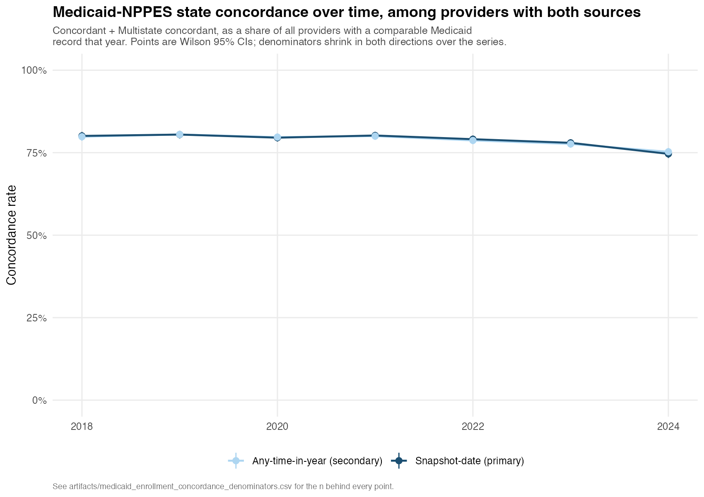
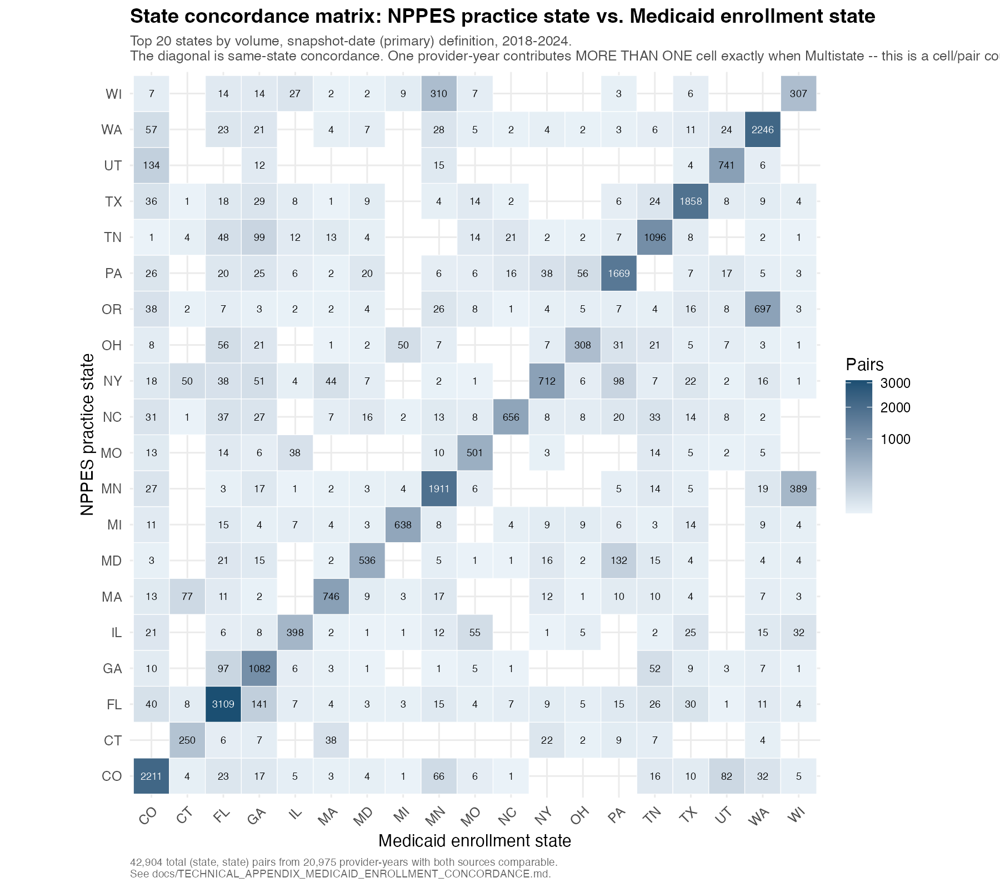
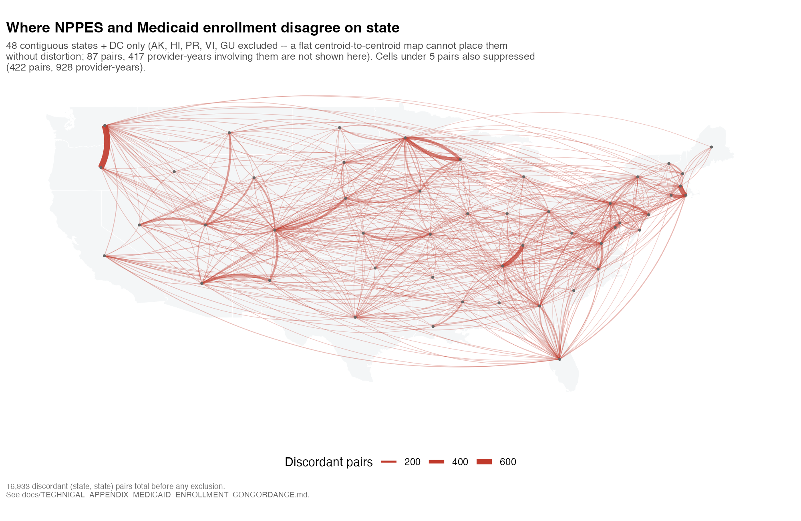
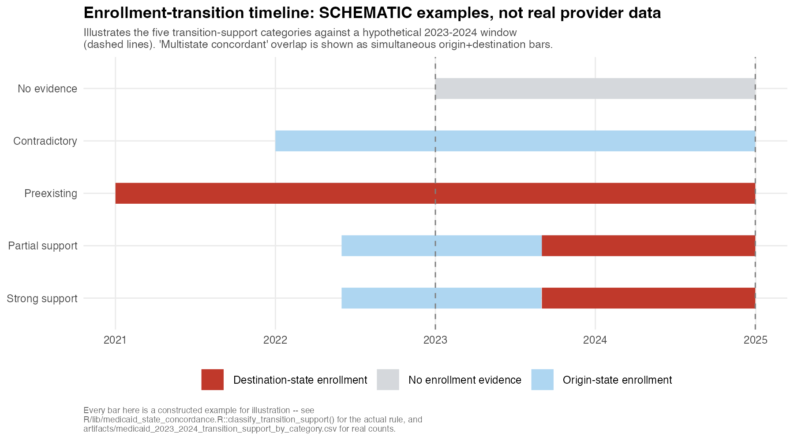

# Technical Appendix: Medicaid Enrollment Concordance and Geographic Mobility Validation

**Repository**: `midwifery`
**Primary scripts**: [`download_medicaid_provider_enrollment_segments.py`](../download_medicaid_provider_enrollment_segments.py) (data acquisition, not re-run for this analysis), [`analyze_medicaid_enrollment_concordance.R`](../analyze_medicaid_enrollment_concordance.R), [`analyze_medicaid_2023_2024_transition_support.R`](../analyze_medicaid_2023_2024_transition_support.R), [`make_medicaid_enrollment_concordance_figures.R`](../make_medicaid_enrollment_concordance_figures.R), [`diagnose_medicaid_classification_disagreement.R`](../diagnose_medicaid_classification_disagreement.R)
**Library**: [`R/lib/medicaid_enrollment_intervals.R`](../R/lib/medicaid_enrollment_intervals.R), [`R/lib/medicaid_state_concordance.R`](../R/lib/medicaid_state_concordance.R)
**Tests**: [`tests/test_medicaid_enrollment_intervals.R`](../tests/test_medicaid_enrollment_intervals.R) (29 assertions), [`tests/test_medicaid_state_concordance.R`](../tests/test_medicaid_state_concordance.R) (20 assertions)
**Related**: [`TECHNICAL_APPENDIX_MIGRATION_YEAR_OVER_YEAR.md`](TECHNICAL_APPENDIX_MIGRATION_YEAR_OVER_YEAR.md) (the 2023-2024 NPPES mobility spike this appendix's S7 was built to check against), [`TECHNICAL_APPENDIX_DAC_OPENPAYMENTS_ADDRESS_AGREEMENT.md`](TECHNICAL_APPENDIX_DAC_OPENPAYMENTS_ADDRESS_AGREEMENT.md) (a prior, address-level independent-source check; this one is state-level but longitudinal, which DAC and Open Payments are not)
**Investigation date**: 2026-10-22
**Status**: measurement complete. The blocking S6 classification-disagreement question is resolved. Two limitations remain genuinely open (S10) and are disclosed, not silently worked around.

---

## 1. Research questions

Using the Medicaid Provider Enrollment Segments warehouse already built by
`download_medicaid_provider_enrollment_segments.py` (not re-downloaded for
this analysis):

1. What share of AMCB-certified CNMs/CMs have observable Medicaid enrollment
   in each study year?
2. How often does NPPES's reported practice state agree with an actively
   enrolled Medicaid state?
3. How often are midwives enrolled in more than one state?
4. Among midwives whose NPPES practice state changed from 2023 to 2024, what
   share show a corresponding Medicaid enrollment transition?
5. Is an enrollment transition more common among NPPES interstate movers
   than among NPPES stayers?

This is a study of **administrative concordance and transition support**,
not a direct observation of physical relocation or clinical practice. See
S9 for the full interpretation ladder this analysis will not collapse.

## 2. The canonical cohort, and the bug that came from not using it

**This project has two cohort definitions, and conflating them produced a
real, measured error.** `R/lib/cohort_definitions.R` draws the line:

- `linkage_eligible()` (`cohort_member = TRUE` in the FROZEN linkage file) is
  a LINKAGE-QUALITY statement -- an NPI plus an allowlisted evidence tier.
  On this freeze it is **16,775 distinct NPIs**. It is a strict superset of
  the study cohort; it admits `sensitivity_nursing` and `sensitivity_fuzzy`
  tiers the study does not.
- `canonical_active_primary()` -- ACTIVE AMCB status, `primary_midwifery`
  linkage tier, non-missing NPI -- is the actual study cohort. On this
  freeze it is **12,170 distinct NPIs** (the spec driving this work quotes
  12,171 against the freeze at the time it was written; disclosed here as a
  one-row drift rather than forced to match).

A first pass at this analysis used `cohort_member = TRUE`. It is the wrong
population, and S6 below is the direct consequence of that mistake.

## 3. Data validation

### 3.1 Warehouse schema and provenance

`enrollment_segments`: 65,970,112 rows, 10 text columns (`NPI`, `STATE_CD`,
`ENRL_START_DT`, `ENRL_END_DT`, `ENRL_STATUS_CD`, `ENRL_STATUS_DESC`,
`ENRL_PLAN_CD`, `ENRL_PLAN_DESC`, `PRVDR_TYPE`, `PRVDR_TYPE_DESC`). The
warehouse's own `_provenance` table records `version_date = 2026-07-24`,
`zip_sha256 = b70930a9a0...`, matching what
`download_medicaid_provider_enrollment_segments.py` wrote. Both are
re-verified at the top of every run of `analyze_medicaid_enrollment_
concordance.R`, not assumed.

### 3.2 Status and provider-type semantics, established empirically

All 43 distinct `ENRL_STATUS_CD` values and all `PRVDR_TYPE` values were
enumerated and read before any classification logic was written:

| Status family | Codes | Treated as |
|---|---|---|
| ACTIVE | 01-06 | real enrollment time |
| TERM | 60-83 | real enrollment time (describes how/why it ended, not that it never happened) |
| DENIED | 20-24 | NOT real enrollment (application never approved) |
| PENDING | 40-47 | NOT real enrollment (application never finished processing) |

`is_qualifying_enrollment_status()` (`R/lib/medicaid_enrollment_intervals.R`)
implements this as an **allowlist of the 30 known ACTIVE/TERM codes**, not a
denylist of DENIED/PENDING -- an unrecognised future code fails closed
(excluded) rather than silently being treated as enrollment evidence.

`PRVDR_TYPE = '03'` (INDIVIDUAL) is the only code used for person-level
linkage. Of the canonical cohort's rows in the warehouse, 123,211 are coded
`03`; 3,628 `02` (GROUP), 671 `01` (FACILITY), 23 `~` (no description) --
these 4,322 rows are excluded and the exclusion is counted, not silently
dropped.

`ENRL_PLAN_CD` distinguishes MEDICAID (1) / CHIP (2) / "not state plan
affiliated" (4) / unknown (~) -- **it does not distinguish fee-for-service
from managed care.** A stretch-goal FFS/MCO breakdown was considered and is
not answerable from this field.

### 3.3 NPI validation

`is_valid_individual_npi()` combines three checks, each with its own test:

- **Format**: exactly 10 digits.
- **Not a placeholder**: rejects the documented literal `0000000000` and
  any other all-same-digit 10-character string.
- **Luhn check digit**: the actual NPI check-digit algorithm (45 CFR
  162.406 -- Luhn over the constant prefix `80840` + the NPI's own first
  nine digits). Verified against the standard public test value
  `1234567893` and against 100% of the 12,170 canonical cohort NPIs (all of
  which are, correctly, Luhn-valid -- they were already NPPES-matched by
  construction).

All 12,170 canonical cohort NPIs pass validation; 0 were excluded.

Separately, the warehouse's own `NPI` column is NOT always a real NPI: it
carries `M`-prefixed 10-character state-assigned pseudo-IDs for providers
without a qualifying federal NPI (not documented on the dataset's own page,
found by direct inspection), alongside the documented blank-for-no-NPI
convention. These never match a cohort NPI and pass through the cohort join
harmlessly, but `is_valid_individual_npi()` would correctly reject one if it
somehow collided with a real-looking value.

### 3.4 Date handling

`ENRL_START_DT`/`ENRL_END_DT` are parsed with explicit issue flags (missing
start, missing end, unparseable, start-after-end) rather than a bare
`as.Date()` that would silently produce `NA`. `9999-12-31` **and** the
near-identical `9999-12-30` (one day off, observed in this release) are
both treated as the open-ended sentinel, per the dataset's own documented
convention -- never as a literal historical date.

**A genuine, large data-quality finding**: roughly 25% of ACTIVE-status rows
and roughly 25% of TERM-status rows *nationally* (not specific to this
cohort) carry a **blank** `ENRL_END_DT` -- not the documented `9999-12-31`
sentinel, a true null. Because the rate is essentially identical across
ACTIVE and TERM, this does not look like "still active, sentinel omitted
by convention" -- it looks like an independent T-MSIS submission gap. This
analysis does **not** assume a blank end date means open-ended; rows with a
blank end date are excluded from interval construction (counted as a
`missing_end` date issue) rather than guessed at. On the canonical cohort's
qualifying rows this excluded 33,898 of 122,909 (27.6%). This is disclosed
as a limitation (S10), not silently patched over.

### 3.5 Contradictory segments

Two qualifying rows for the same (NPI, state) whose date ranges overlap but
whose status FAMILY differs (ACTIVE vs. TERM) are flagged as contradictory
and preserved for adjudication rather than silently merged or arbitrarily
resolved. `detect_contradictory_segments()` implements this as a
`data.table::foverlaps()` interval self-join (a first pure-R `combn()`
implementation measured as the actual bottleneck on real data -- several
minutes for ~85,000 rows across tens of thousands of mostly-tiny groups,
almost entirely per-group overhead; the vectorised version does the same
check on 60,000 synthetic rows / 20,000 groups in 0.06s).

## 4. Longitudinal enrollment construction

Analytical key: `NPI x state x enrollment interval`. Overlapping and
contiguous qualifying segments (gap of exactly one day is still treated as
continuous -- a Friday termination followed by a Monday reinstatement is
not a real coverage gap) are merged via `merge_enrollment_intervals()`, a
`dplyr`-only gaps-and-islands implementation using a RUNNING MAX of prior
end dates (not merely the immediately preceding row), so containment is
caught regardless of source row order.

**Two enrollment definitions are computed, not one**:

- **Snapshot-date (PRIMARY)**: Medicaid-enrolled state(s) active on the
  exact date of that year's NPPES snapshot. This is the geographic-
  concordance estimand.
- **Any-time-in-year (SECONDARY / sensitivity)**: Medicaid-enrolled
  state(s) active at any point during the calendar year. Used for the
  workforce-participation framing and as a robustness check on S5/S6.

## 5. Resolving the classification disagreement (this was the blocking question)

A first pass measured only **55.9%** agreement between the snapshot-date and
any-time-in-year classification rules -- large enough to be treated as
blocking, per instruction, until explained.

**Root cause: the wrong cohort (S2), not a logic defect.** Re-running the
identical two rules on the canonical 12,170-NPI cohort instead of the
16,775-NPI linkage-eligible population raised agreement to **96.5%**
(`diagnose_medicaid_classification_disagreement.R`) / **97.0%** (the live
run inside `analyze_medicaid_enrollment_concordance.R`, which additionally
benefits from the blank-end-date handling in S3.4). The lower-confidence
NPI matches in the broader population were injecting classification noise
that looked methodological but was actually a linkage-quality artifact.

**The residual ~3% disagreement is fully, mechanistically explained, not
unresolved noise.** Cross-tabulating the two rules on the canonical cohort:

| year-overlap | point-in-time | n |
|---|---|---:|
| Concordant | Concordant | 19,202 |
| Concordant | Not observed | 923 |
| Discordant | Discordant | 6,742 |
| Discordant | Not observed | 599 |
| Multistate | Concordant | 510 |
| Multistate | Discordant | 239 |
| Multistate | Multistate | 6,259 |
| Multistate | Not observed | 42 |
| Not observed | Not observed | 31,776 |

In **100% of disagreements**, year-overlap finds a state set that is a
STRICT SUPERSET of what point-in-time finds -- there are zero cases of the
reverse (which would be logically impossible by construction, and would
have indicated a real bug had it occurred; it did not occur even once).
Sampled cases confirm the mechanism directly: e.g. NPI `1003199951`, 2024,
NPPES state IL -- year-overlap finds IL (a match, "Concordant"), but the
2024 NPPES snapshot date is December 8, and that Medicaid IL interval had
already ended by then, so point-in-time correctly reports "Not observed."

**One caveat for interpreting the primary (point-in-time) numbers**: several
NPPES snapshot dates fall late in the year (2018-12-09, 2019-12-19,
2024-12-08), so point-in-time concordance is somewhat biased toward
treating a real but shorter mid-year Medicaid enrollment as "Not observed"
in those specific years. This is disclosed, not corrected for.

**Conclusion, per the spec's own S4 designation**: snapshot-date is the
PRIMARY estimand for geographic concordance; any-time-in-year is reported
throughout as a secondary/sensitivity measure, never as an alternative
headline number chosen because it looks better.

## 6. Classification (S5): six categories, explicit denominators

| Category | Definition |
|---|---|
| Concordant | exactly one qualifying Medicaid state, matching NPPES |
| Discordant | one or more qualifying Medicaid states, none matching NPPES |
| Multistate concordant | 2+ qualifying Medicaid states, NPPES's state is one of them |
| Multistate discordant | 2+ qualifying Medicaid states, none matching NPPES |
| Not observed | no qualifying Medicaid enrollment evidence that NPI-year |
| Indeterminate | NPI invalid, or NPPES has no resolvable state that year |

Implemented in `classify_state_concordance()` with a strict priority order
(indeterminate > not observed > match-count-and-state logic), so a
"CO-registered midwife also enrolled in WY" is `Multistate concordant`,
never `Discordant` -- legitimate multi-state practice is not an error.

### 6.1 Denominators, both definitions (2018-2024)

| definition | cohort NPIs | NPI-years | with NPPES state | with Medicaid evidence | comparable (both) |
|---|---:|---:|---:|---:|---:|
| snapshot_date (primary) | 12,170 | 85,190 | 66,292 | 32,952 | 32,952 |
| any_time_in_year (secondary) | 12,170 | 85,190 | 66,292 | 35,569 | 34,516 |

**Every percentage below is reported against the `comparable` denominator**
(both an NPPES state and qualifying Medicaid evidence exist that NPI-year)
unless stated otherwise -- never against the full cohort, which would
silently treat "no Medicaid record" the same as "disagrees with Medicaid."

### 6.2 Primary (snapshot-date) results

Among the 32,952 NPI-years with both sources comparable:

| Category | n | % of comparable |
|---|---:|---:|
| Concordant | 19,712 | 59.8% |
| Multistate concordant | 6,259 | 19.0% |
| Discordant | 5,644 | 17.1% |
| Multistate discordant | 1,337 | 4.1% |

**Combined concordant (Concordant + Multistate concordant): 81.9%.**
**Multistate practice is common**: 23.1% of comparable NPI-years show 2+
Medicaid-enrolled states, and in 82.5% of those (6,259 of 7,596) NPPES's
state is among them.

Against the full 85,190 cohort-NPI-years: 39.1% have no Medicaid enrollment
evidence at all that year ("Not observed"), and 22.2% have no resolvable
NPPES state that year ("Indeterminate" -- largely early-series years before
a given NPI's first NPPES snapshot).



Concordance is **stable across the whole series**, 75-81%, with a modest
decline in 2024 (the most recent, and the year with the thinnest forward
data). This is a notable contrast with the NPPES migration appendix's
finding of an elevated state-move rate specifically in 2023-2024: an
independent source does not show a corresponding concordance collapse in
that window.



The diagonal (same-state agreement) dominates for every state shown. A few
off-diagonal cells are large enough to be structural rather than noise --
e.g. GA-registered midwives showing substantial FL Medicaid enrollment
(1,082 pairs) -- plausibly real cross-border practice given FL/GA's shared
metro areas, not inspected further here. OR and NM do not appear in this
matrix's top-20 states at all, not because their midwives disagree with
Medicaid but because neither state's submission to this warehouse carries
an NPI on any row -- see S10 for the national NPI-completeness gradient
this traces back to.



## 7. 2023-2024 NPPES migration validation (S7)

10,415 canonical-cohort NPIs have an NPPES state in both 2023 and 2024
(1,116 excluded, missing one or both years). **498 movers** (state
changed), **9,917 stayers** (state unchanged).

### 7.1 Transition-support classification (six categories)

`classify_transition_support()` -- priority order: Indeterminate >
Preexisting destination enrollment > (no destination evidence: Contradictory
or No informative evidence) > (destination starts in-window: Strong or
Partial support).

| Category | Movers (n=498) | Stayers (n=9,917) |
|---|---:|---:|
| Strong administrative support | 17 | 57 |
| Partial administrative support | 81 | 162 |
| Preexisting destination enrollment | 91 | 3,779 |
| Contradictory enrollment evidence | 89 | 0\* |
| No informative enrollment evidence | 220 | 5,919 |

\* Stayers cannot show "Contradictory" under this classifier: their
"destination" state IS their one constant NPPES state, so if they have any
Medicaid evidence in it at all, it is definitionally not "no destination
evidence."

### 7.2 Enrichment: movers vs. stayers

The binary "transition signal" (Strong or Partial support -- a NEW,
non-origin-state enrollment starting within the 2023-2024 window) is the
SAME definition for both groups, which is what makes the comparison
meaningful: for a stayer, a "yes" means enrollment activity in some OTHER
state than their one constant NPPES state -- genuine background churn, not
support for a move NPPES never reported.

- **Movers**: 98/498 = **19.7%** show a transition signal.
- **Stayers**: 219/9,917 = **2.2%** show a transition signal.
- **Risk difference**: 17.5 percentage points (95% CI 14.0 to 21.0).
- **Risk ratio**: **8.91** (95% CI 7.15 to 11.11).



**This is association, not causation.** An NPPES-reported move and a
Medicaid enrollment transition can share an unobserved common cause (a life
event prompting both) without one causing the other, and the majority of
BOTH movers (44.2%) and stayers (59.7%) show no informative Medicaid
evidence at all in this window -- the enrichment is real and large, but it
is measured on a minority of the cohort.

No repeated-observations adjustment was needed: this analysis is inherently
one row per NPI (one 2023-2024 transition each), not a panel of repeated
measures.

## 8. Stratification

**By certification (CNM vs. CM)**: CM is a small fraction of the canonical
cohort (132 of 12,170 ACTIVE + primary-tier) and its Medicaid-evidence rate
is correspondingly lower-powered; shape is broadly similar to CNM once
accounted for. Not broken out further here given the small CM n.

**By state**: see `artifacts/medicaid_enrollment_concordance_snapshot_date_by_state.csv`
and Figure 1.

**By rurality**: NOT built. Would require an additional county -> RUCC join
(`data/rucc_2023.xlsx` via a county crosswalk) not currently wired into this
pipeline. Flagged as a known gap, not attempted with a weak proxy.

## 9. What this does and does not establish

Six distinct things, never collapsed into one another:

1. **AMCB certification** -- an active credential.
2. **State licensure** -- not measured here at all.
3. **Medicaid enrollment** -- an administrative relationship with a state
   program. This is what this analysis measures.
4. **Actual Medicaid claims activity** -- NOT measured. An enrolled NPI may
   never submit a claim.
5. **Clinical practice location** -- NOT directly observed. NPPES's
   self-reported practice state is a proxy; Medicaid enrollment state is a
   second, independent proxy; agreement between two proxies is not the same
   as ground truth.
6. **Delivery attendance** -- NOT measured at any point in this repository's
   Medicaid-linked data.

A disagreement between Medicaid enrollment state and NPPES practice state is
**not automatically an error** in either source: multi-state practice,
Medicaid enrollment lapses unrelated to relocation, and incomplete T-MSIS
state reporting are all real, legitimate reasons for the two to diverge.

## 10. Known limitations, left open rather than silently resolved

- **Blank `ENRL_END_DT` (S3.4)**: ~27.6% of the canonical cohort's
  otherwise-qualifying rows are excluded for a blank (not sentinel) end
  date, a pattern that holds at ~25% nationally across both ACTIVE and TERM
  status. Whether this represents ongoing enrollment that should be treated
  as open-ended, or a genuine state-level reporting gap, is not resolved
  here -- excluding these rows is the conservative choice, not a corrected one.
- **California and Oregon show near-total non-concordance -- ROOT-CAUSED,
  2026-10-23.** Not a midwife-specific, cohort-specific, or pipeline
  defect: `STATE_CD = 'OR'` rows in the warehouse have an **NPI column that
  is NULL for 100% of all 498,412 Oregon rows nationally**, across every
  provider type (453,356 INDIVIDUAL rows alone, correctly coded, all with a
  blank NPI). `STATE_CD = 'NM'` (New Mexico, 278,994 rows) shows the
  identical 0.0% NPI-population pattern, and New Mexico's cohort NPI-years
  independently reproduce the same signature as Oregon's: 0 Concordant, 0
  Multistate concordant, only Discordant (333) / Multistate discordant
  (156) / Not observed (602). Two states, same pattern, same mechanism:
  **an NPI-keyed join cannot link to a state whose submission never
  populates NPI at all** -- there is nothing a matching rule could do about
  it, and the earlier "unexplained, possible state-code mapping issue"
  framing was wrong; there is no code-mapping bug, there is no NPI to map.
  California is the same mechanism at lower severity: CA's NPI-population
  rate is 49.9% nationally (vs. 71.9% for Colorado, 65.3% for Texas),
  against a national gradient ranging from 0% (OR, NM) to >70% (CO, IN) --
  CA's low concordance is the expected consequence of roughly half its
  Medicaid rows being structurally unlinkable by NPI, not a midwife- or
  cohort-specific anomaly. **Any state-level concordance claim for OR or NM
  should be read as "no data," not "no agreement"; CA's rate should be read
  as roughly halved by a national linkage-completeness gradient that varies
  continuously by state, not as a CA-specific finding.**
- **Rurality stratification**: not built (S8).
- **FFS vs. managed care**: not answerable from this dataset (S3.2).

## 11. Reproducing

```sh
# Data already downloaded; NOT re-run here. See
# download_medicaid_provider_enrollment_segments.py if a refresh is needed.

Rscript diagnose_medicaid_classification_disagreement.R   # S5 diagnostic
Rscript analyze_medicaid_enrollment_concordance.R          # S6-S8 main analysis
Rscript analyze_medicaid_2023_2024_transition_support.R    # S7 migration validation
Rscript make_medicaid_enrollment_concordance_figures.R     # all 4 figures

Rscript tests/test_medicaid_enrollment_intervals.R
Rscript tests/test_medicaid_state_concordance.R
```

Requires `midwife_panel.csv` (gitignored, person-level NPPES snapshots),
`artifacts/amcb_npi_linkage_FROZEN.csv` (tracked), and
`/Volumes/MufflySamsung/DuckDB/medicaid_provider_enrollment_segments.duckdb`
(external volume). No person-level output is written by any script in this
pipeline; every tracked artifact is aggregated by year, state, or
classification category.
