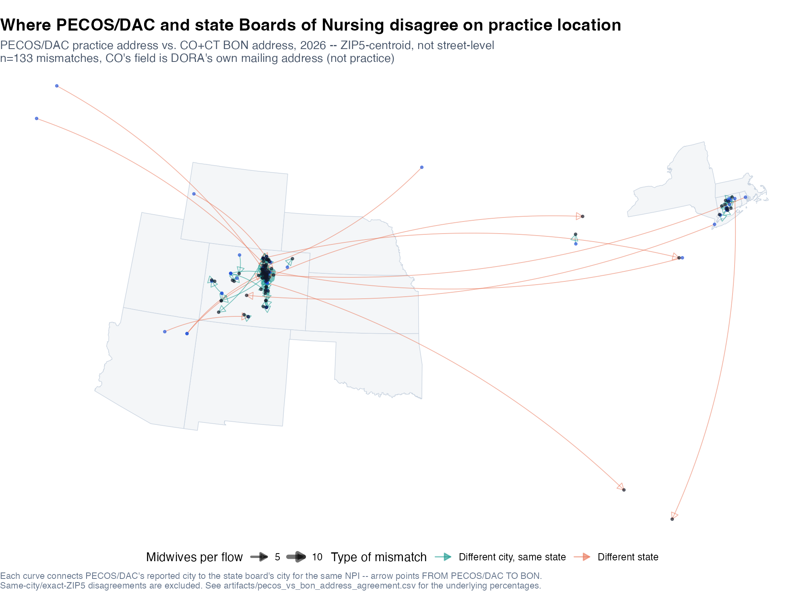

# Technical Appendix: Multi-Source Address Agreement

**Repository**: `midwifery`
**Primary scripts**: [`compare_pecos_to_nppes_address.R`](../compare_pecos_to_nppes_address.R), [`compare_healthgrades_to_nppes_address.R`](../compare_healthgrades_to_nppes_address.R), [`compare_healthgrades_to_pecos_address.R`](../compare_healthgrades_to_pecos_address.R), [`compare_pecos_to_doximity_address.R`](../compare_pecos_to_doximity_address.R), [`compare_pecos_to_bon_address.R`](../compare_pecos_to_bon_address.R), [`make_address_agreement_heatmap.R`](../make_address_agreement_heatmap.R), [`build_pecos_bon_address_flow_pairs.R`](../build_pecos_bon_address_flow_pairs.R), [`make_pecos_bon_address_flow_map.R`](../make_pecos_bon_address_flow_map.R)
**Shared logic**: [`R/lib/address_agreement_compare.R`](../R/lib/address_agreement_compare.R) (`shape_address()`, `compare_address_pair()`), mutation-tested by [`tests/test_address_agreement_compare_saboteur.R`](../tests/test_address_agreement_compare_saboteur.R) against [`tests/mutation_catalogue.R`](../tests/mutation_catalogue.R)
**Investigation date**: 2026-10-23; updated 2026-10-26 (Florida added)
**Status**: five comparisons, all NPI-joined, all year-labeled on sight. Street was tried and dropped from every one of them (§2). One state-board input (Colorado) was removed outright, not caveated; California was added with no state or ZIP field at all; Florida was added with full city/state/zip and is now the state-board comparison's largest single contributor at every level (§4).

---

## 1. Why this exists

Every address-based result in this repository ultimately rests on one
source or another's claim about where a midwife practices. This appendix
checks how often independent sources agree with each other at all, across
every pairing this project has built a comparison for: PECOS/DAC against
NPPES, against Doximity, and against state Boards of Nursing; Healthgrades
against both NPPES and PECOS/DAC. One question, asked five ways: **if you
ask two different systems where the same provider practices, how often do
they give the same answer, and at what level of geographic precision does
that stop being true?**

The honest answer, stated up front: **state-level agreement is high
everywhere (89.8-95.3%). City and ZIP5 agreement drop well below that
everywhere, and by how much depends on what kind of address is actually
being compared, not on how "good" any one source is.**

## 2. Method, shared across all five comparisons

Every comparison uses the same two functions
([`R/lib/address_agreement_compare.R`](../R/lib/address_agreement_compare.R)):

1. **`shape_address()`** reduces each source's raw columns to a common
   `(npi, state, city, zip5)` shape — state/city upper-cased and
   whitespace-squished, zip5 the first 5 characters of a standalone zip
   column (`"substr"` mode) or the last 5 digits of a combined field like
   Doximity's `"City, ST ZIP5"` (`"trailing5"` mode).
2. **`compare_address_pair()`** inner-joins two shaped tables by NPI and
   reports, for each of state/city/ZIP5, `comparable_n` (rows where
   **both** sides have a non-blank value at that level) and `agree_n` (of
   those, how many match exactly). A source missing an entire field (no
   zip column, no independent state column) produces NA there rather than
   an empty string or a fabricated value — `shape_address()`'s `zip_col`
   and `state_col` both accept `NULL` for exactly this case (added
   2026-10-23 for California, §4) — and NA is excluded from that level's
   `comparable_n` the same way a blank value is, so the source still
   contributes real rows at whichever levels it actually has.

**Street was tried and dropped from every comparison in this project
(2026-10-23).** It never produced a usable number: lowest was 21.7% on
PECOS vs. Doximity, driven partly by Doximity's scraped `address_line`
smashing suite text onto the street with no separator (`"1 Baltimore Pl
NWSte 105"`), which no normalizer reliably untangles. ZIP5 is the finest
grain any comparison here reports.

**Every comparison is NPI-joined**, not name-matched directly — Doximity
and the state-board data don't carry an NPI natively, so each adds its own
second join (certification_number → npi via the tracked roster for
Doximity; the harvest scripts already carry npi for BON). See each
script's own header for exactly how.

## 3. Results


| Comparison | State | City | ZIP5 | n |
|---|---:|---:|---:|---:|
| PECOS/DAC (2026) vs NPPES (2026) | 89.8% | 55.6% | 47.1% | 5,576 |
| PECOS/DAC (2026) vs Doximity (name-matched, undated) | 90.7% | 57.8% | 49.2% | 1,822 |
| Healthgrades (scraped) vs PECOS/DAC (2026) | 95.3% | 55.4% | 50.0% | 148 |
| Healthgrades (scraped) vs NPPES (2026) | 94-95% | 67-68% | 62-64% | 400-540\* |
| PECOS/DAC (2026) vs BON (CA+IL+CT+DE+FL pooled) | 92.5% (n=239) | 35.5% (n=462) | 35.6% (n=239) | — |

\*Healthgrades' underlying scrape is still running in another session as
of this writing; its n (and the percentages built on it) will keep
shifting until that finishes. The BON row's n is deliberately not uniform
across levels — see §4.

ZIP5 is the headline grain this project treats as primary (outlined/bold
in the figure). It ranges from 47-64% among the four comparisons where
both sides are asking the same underlying question ("where does this
person practice") — genuinely substantial disagreement even there — and
sits at 35.6% for the state-board comparison (§4), now a real,
well-powered number (n=239) rather than the n=15 curiosity it was before
Florida was added, though still below the other four comparisons' band.

## 4. The state-board comparison: uneven coverage, one removed, n varies by level

Eight states have a live Board-of-Nursing harvest script in this project
(WA, CO, TX, CA, IL, CT, DE, FL). **Three never had usable address data at
all, one was removed on purpose, and the five that remain don't even
report the same `n` across state/city/ZIP5** — each state's board
publishes a different subset of fields, and `shape_address()` (§2) now
reports NA, not a fabricated value, for whichever fields a given state
simply doesn't have.

- **WA has no address field at all**, confirmed by querying
  `data.wa.gov`'s live API directly (2026-10-23), not assumed from the
  harvest script's existing columns: the full field list is
  `credentialnumber, lastname, firstname, middlename, credentialtype,
  status, birthyear, actiontaken, firstissuedate, lastissuedate,
  expirationdate`. No city, state, or zip anywhere in the dataset.
- **TX has no standalone city/state/zip field either**, same live-query
  check. It carries `county_of_residence` (county, not city — and
  *residence*, not *practice*, a third kind of address-type mismatch
  alongside Colorado's) and `place_of_employment`, a free-text field
  (`"Texas Health Resources 6200 West Parker Road Plano TX"`) with no ZIP
  at all and not even reliably present. Regex-extracting a trailing state
  code was considered and rejected — the same fragile-free-text-parsing
  move already rejected for Doximity's street and for this field's own
  non-ZIP content, and it wouldn't help regardless, since the actual
  disagreement shows up at city/ZIP5, which TX structurally cannot supply.
- **CO was tried, then removed outright (2026-10-23), not caveated.**
  Colorado DORA's field is explicitly `mailzipcode` — a board-reported
  *mailing* address, not a practice address, while every other side of
  every comparison in this appendix is a practice-location field.
  Including it (as a per-state row, or pooled into the headline number)
  compared a mailing address against a practice address and reported the
  result as if it were the same kind of disagreement the other states
  measure. It was 166 of the pre-removal pooled sample's 181 records and
  drove pooled ZIP5 agreement to 6.6%.
- **CA was added 2026-10-23, with no state or ZIP field at all.** The
  California DCA's public Board of Registered Nursing roster carries
  license number, status, city and county — nothing else. It has no
  independent state field (every row is already scoped to CA by
  construction of the source itself, so substituting some other state
  value would be circular, not a genuine board-reported check), and no zip
  field exists anywhere in the dataset. It is, however, by a wide margin
  the **largest BON sample in this project**: 1,341 verified matches
  (`harvest_live_california_bon_from_tracked_roster.py`, matched by
  last+first name against the tracked cohort — the CA DCA roster carries
  neither an NPI nor an AMCB identifier), of which 223 also have a
  PECOS/DAC NPI to compare against. It contributes **city only**: 24.7%
  agreement on its own (n=223), close to CT's 21.4% (n=14) — the two
  independent city-level numbers corroborate each other, not an accident
  of one noisy small sample.
- **IL, CT and DE carry a structured, board-reported city/state/zip** with
  no documented mailing-vs-practice distinction. Of those: **DE
  contributes 0 rows** (no DE-practicing midwife is in the tracked cohort
  yet — an honest zero, not an error) and **IL contributes 1** (not a
  usable percentage). **CT contributes 14** — a meaningful share before
  Florida was added, now a small piece of a much larger picture.
- **FL was added 2026-10-26, and is this comparison's largest single
  contributor at every level.** Florida has no CNM-specific profession
  category at all — nurse-midwives, nurse practitioners, CRNAs and
  clinical nurse specialists all share one "Advanced Practice Registered
  Nurse" license type — so
  `harvest_live_florida_bon_from_tracked_roster.py` accepts a name match
  only when the license's own Qualifications field lists "Certified Nurse
  Midwife": 813 of 1,035 FL-state cohort members verified this way, 81
  APRN name matches correctly excluded as NOT CNM-qualified (a match
  under the right name that isn't actually a midwife), 0 ambiguous. Of
  those 813, 224 also have a PECOS/DAC NPI to compare against — by itself
  more comparable rows than every other state-board source in this
  project combined. The harvester's first committed version only captured
  the detail page's street line; the real city/state/zip line sits two
  `<dt>/<dd>` pairs later in the HTML and was silently dropped. Fixed and
  the full cohort re-harvested before this update — confirmed live
  against several real records, including the "no address on file" case
  (a disclaimer paragraph precedes the real address block there, which
  the fix had to parse around rather than mistake for the address).

Adding Florida also exposed a separate, pre-existing bug: the filter that
excludes non-matched rows before pooling used `nzchar(npi)` alone, which
does not exclude `NA` — the same `nzchar(NA) == TRUE` behavior already
documented and guarded against inside `compare_address_pair()` itself,
just not here. A VERIFIED_LIVE_BON row whose cohort member has no linked
NPI reads as a blank CSV cell, which becomes `NA` after `read_csv()`, and
`nzchar(NA)` doesn't filter it out. With only CA/IL/CT/DE pooled this
never collided; adding FL's own NA-npi row made two such rows land on the
same `NA` "key" with different cities, and `assert_unique_keys()`
correctly refused to silently resolve the conflict. Fixed by filtering
`!is.na(npi)` before `nzchar(npi)`, not after.

Removing CO did not rescue the ZIP5 number on its own: CT alone was still
only 7.1% before Florida entered the mix. Florida is what actually moved
it — pooled ZIP5 agreement went from 6.7% (n=15, effectively CT alone) to
35.6% (n=239, FL carrying 224 of those rows), and pooled city agreement
from 24.4% (n=238) to 35.5% (n=462). This is still below the 47-64% band
the four practice-vs-practice comparisons in §3 occupy, but it's no
longer a sample too small to say anything with — it's a real number built
on the largest BON-side comparable sample in this project.



This map still covers Connecticut only — it predates Florida's addition
and has not yet been extended to it. CA has no ZIP field, and the ZIP5-
centroid geocoding method this map uses (§6) has no equivalent for a
city-only source; mapping CA's mismatches would need a city-centroid
lookup this project doesn't currently have. Florida has no such
limitation (it carries a real ZIP5) and, at n=224, would be by far the
largest flow this map could show — extending it is a natural next step,
not done as part of this update. 11 of CT's 14 comparable records
disagree at city level or coarser — a dense local cluster around
Hartford/New Haven plus one out-of-state flow (Danbury CT → Tamarac FL).

## 5. What this does and does not establish

- **There is no single ground-truth address for a midwife in this
  project's data.** Every source captures a different facet: PECOS/DAC is
  an enrolled organization's address (sometimes a national telehealth
  company or an out-of-state health system HQ — see the DAC/NPPES and
  PECOS/BON flow maps' own long-haul, different-state flows); NPPES is a
  self-report; Doximity is a name-matched commercial directory profile;
  Healthgrades is a scraped directory listing; state boards are sometimes
  a mailing address, sometimes a practice address, and don't always say
  which.
- **State-level agreement is consistently high (89.8-95.3%) across every
  comparison.** Nobody disagrees about which *state* a midwife practices
  in. The disagreement is entirely a finer-grain phenomenon.
- **ZIP5 agreement among the four practice-vs-practice comparisons sits in
  a real, substantial-disagreement band (47-64%)**, not a floor-vs-ceiling
  split between one "good" and one "bad" source. Healthgrades vs. NPPES is
  the best of the four at 63.5%; none of the four exceeds two-thirds
  agreement.
- **The state-board comparison measures something structurally different**
  from the other four — coverage (2 of 8 states have no usable address
  field at all), address type (Colorado's was a mailing address; removed
  rather than caveated), field availability (California has city but no
  state or ZIP), and scope (Florida's CNM identification depends on a
  Qualifications-field screen this project had to build, not a clean
  profession-code filter) all limit what it can say. ZIP5 is now
  well-powered (n=239, driven mostly by Florida's 224) rather than resting
  on Connecticut alone, and city-level agreement (n=462) is powered by
  three independent sources agreeing within a similar range (24.7% CA,
  21.4% CT, 47.3% FL) — real signal, not noise, though FL's own number
  sits noticeably higher than CA's and CT's, worth keeping in mind rather
  than averaging away. It should not be read as "state board data
  disagrees with PECOS" in general — only as what the specific states with
  usable data actually show.
- **It does not identify which source is "right."** Nothing here
  establishes a ground truth to measure the others against; it measures
  mutual agreement only.

## 6. Reproducing

```sh
# PECOS/DAC vs NPPES
Rscript compare_pecos_to_nppes_address.R

# Healthgrades vs NPPES, and vs PECOS/DAC
Rscript compare_healthgrades_to_nppes_address.R
Rscript compare_healthgrades_to_pecos_address.R

# PECOS/DAC vs Doximity (two-hop join: certification_number -> npi)
Rscript compare_pecos_to_doximity_address.R

# PECOS/DAC vs state Boards of Nursing (CA/IL/CT/DE/FL; per-state + pooled rows)
Rscript compare_pecos_to_bon_address.R

# Combined heatmap (all five artifacts above)
Rscript make_address_agreement_heatmap.R

# PECOS/DAC vs BON mismatch flow map (ZIP5-centroid; CT only)
Rscript build_pecos_bon_address_flow_pairs.R
Rscript make_pecos_bon_address_flow_map.R
```
