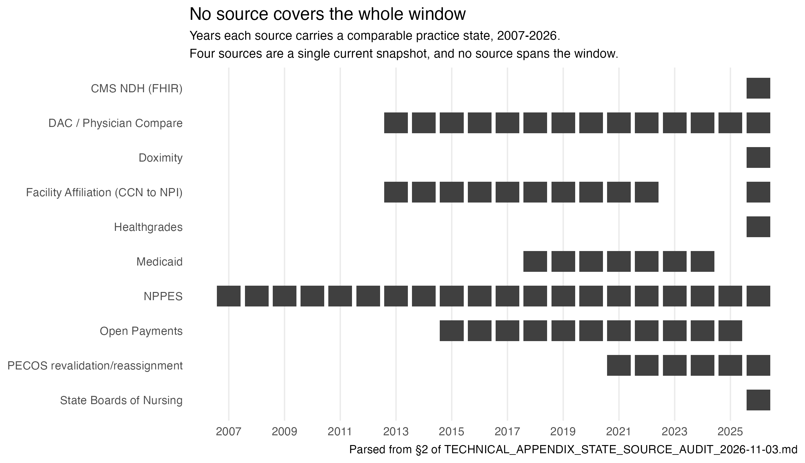
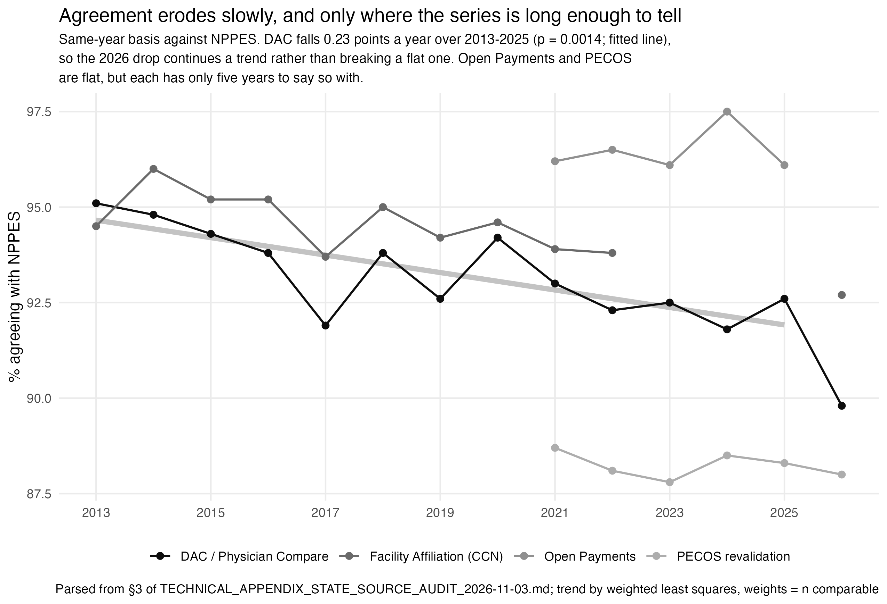
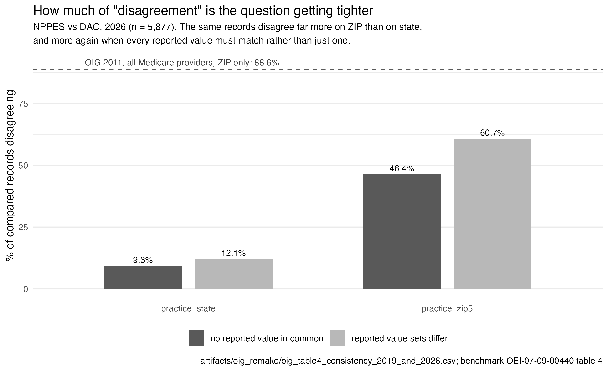
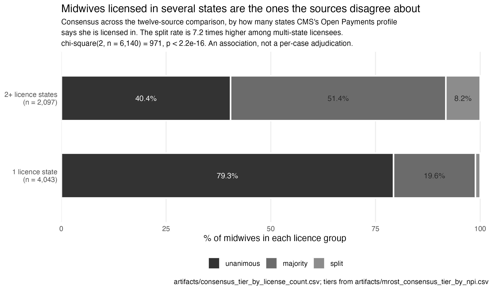
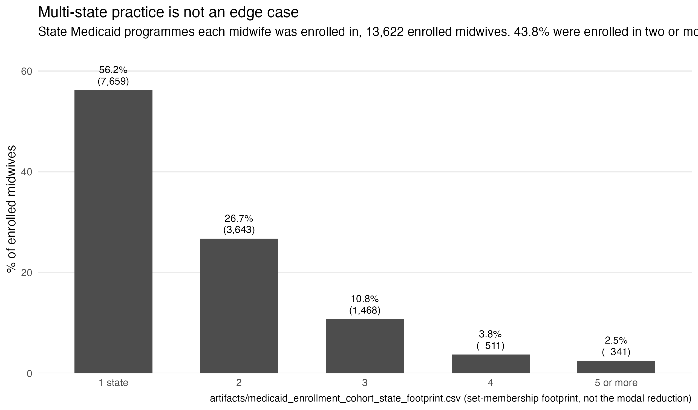
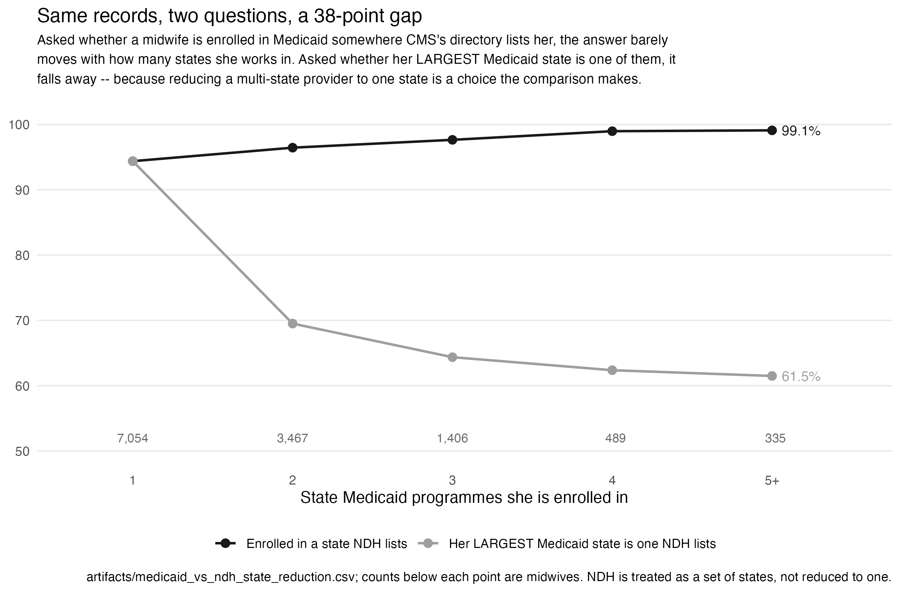

# A Vignette: Ten Sources Disagree About Where Midwives Practice — and That Turns Out to Be the Finding

*A narrative companion to [`TECHNICAL_APPENDIX_STATE_SOURCE_AUDIT_2026-11-03.md`](TECHNICAL_APPENDIX_STATE_SOURCE_AUDIT_2026-11-03.md). Sections 1 through 4 below draw their numbers from that appendix; the OIG comparison and the Medicaid section postdate it and name their own artifacts inline. The figures read the appendix too — `make_state_source_audit_figures.R` parses its §2 and §3 tables rather than restating them, so a figure here cannot disagree with the table there. Corrections applied 2026-11-12 are listed at the end.*

## The question nobody could answer cleanly

Ask "where does this midwife practice?" and ten different federal, state, and
commercial sources will each hand you an answer — NPPES, CMS's Doctors &
Clinicians file, PECOS, Open Payments, two hospital-affiliation routes, state
boards of nursing, CMS's National Downloadable Health directory, Healthgrades,
Doximity. None of them is a gold standard. Each is a self-report, a claims
byproduct, a licensing record, or a commercial scrape, built for a purpose
that has nothing to do with answering this particular question precisely.

The instinct, faced with ten imperfect witnesses, is to average them: have
the sources vote, report the majority answer, move on. This repository's own
prior audit makes clear why that instinct is wrong here — on the handful of
cases where Open Payments, Healthgrades, and Doximity could all be compared
directly, they agreed on **zero of five**. A majority vote across sources that
disagree that badly wouldn't surface the truth; it would manufacture a
consensus none of the underlying sources actually support. So this audit
never pools. It reports every pairwise disagreement as a finding in its own
right, and the payoff is a question the averaged version could never have
asked: *why* do they disagree?

## A slow erosion that five points overstated and thirteen points measured

The most basic fact — does agreement with NPPES erode over time, the way a
reasonable prior would suggest as records age and go stale? — turns out to be
true, but much smaller than the first look suggested, and the gap between
those two readings is the lesson.

An earlier pass of this audit had DAC/Physician Compare at five scattered
vintages — 2013, 2014, 2015, 2016, then a nine-year jump to 2026 — and the
two endpoints looked like a steep decline. Filling in the missing years (they
were sitting, unused, in an already-mounted DuckDB file the whole time)
shrank it to something far gentler. Across the thirteen consecutive years
2013–2025, DAC agreement sits in a narrow 91.8–95.1% band and falls by
**0.23 percentage points a year** (weighted least squares, p = 0.0014) — a
fitted 2.7-point drop over thirteen years. Real, statistically clear, and
roughly a tenth the slope the five-point version implied.

That also reframes 2026's 89.8%. It is the lowest value in the series, but it
is close to what the existing trend predicts rather than a break from a flat
line, so it needs no separate explanation; next year's pull remains the test
of whether the slope is steepening.

The other three multi-year sources are flat — Open Payments +0.06 points a
year (p = 0.81), PECOS −0.03 (p = 0.83), Facility Affiliation −0.13 (p =
0.10) — but Open Payments and PECOS have only five years each, which is not
enough to detect a slope this size. Reporting them as "flat" alongside DAC's
measured decline would confuse an absence of evidence with evidence of
absence. The honest summary: where the series is long enough to tell,
agreement erodes slowly; everywhere else the question is still open.

## The source that looked worst was being asked a different question

PECOS revalidation sits at 87.8–88.7% agreement with NPPES across six
straight years — consistently the lowest of the administrative sources, and
by enough of a margin that it reads, at first, like the weak link in the
chain. But that framing assumes NPPES is the right thing to compare against.
Pairwise — PECOS against every other source directly, not funneled through
NPPES as an anchor — PECOS agrees about as well as the other sources agree
with *each other*. Anchoring to NPPES made PECOS look like an outlier because
NPPES itself turned out not to be a neutral reference point; freed from that
anchor, PECOS isn't an outlier at all. The number that moved wasn't PECOS's
accuracy. It was the question being asked of it.

What the pairwise comparison surfaces instead is a different low point:
**CMS's own National Downloadable Health directory**. Among the 21 same-year
2026 pairs across the six current-snapshot sources, NDH disagrees most with
four separate counterparts — DAC, Doximity, Healthgrades, and PECOS, not just
NPPES. A source that disagrees with nearly everyone, rather than with one
specific counterpart, points at itself as the common denominator — exactly
the kind of signal that a single anchored comparison against NPPES would
never have revealed, because NDH was never being compared against the
sources it actually struggles to agree with.

## Somebody already asked this, in 2011

In May 2013 the HHS Office of Inspector General published
[OEI-07-09-00440](https://oig.hhs.gov/oei/reports/oei-07-09-00440.asp),
*Improvements Are Needed To Ensure Provider Enumeration and Medicare Enrollment
Data Are Accurate, Complete, and Consistent*. Its table 4 is this audit's
question, asked fifteen years earlier against the whole Medicare provider
population: of 987,266 providers listed in both NPPES and PECOS, **97.4% had at
least one variable that did not match**, and practice-location address
disagreed for 88.6% of them.

Two of OIG's four tables cannot be recreated here, and the reason is the more
interesting half of the comparison. OIG's tables 1 and 2 report how *inaccurate*
NPPES and PECOS are — 48% and 58% of records respectively — and they get that
number by **asking the providers**: a survey of 126 practitioners, weighted to
the population, confirming or correcting their own records. That is a gold
standard, purchased by going and getting one. This audit has no such thing, by
construction; every section above measures *agreement*, which is what you can
compute when nobody is available to referee. Accuracy and agreement are not
the same measurement and neither bounds the other. Two sources can agree
perfectly and both be wrong.

What does carry across is table 4, and only on the row where the methodology
lines up. OIG matched addresses on the ZIP portion alone — their own footnote
warns this "may overestimate the consistency between addresses" — so their
practice-location row is a ZIP comparison, and it belongs beside this project's
ZIP5 level rather than its city or state level.

| Provider variable | OIG 2011, NPPES vs. PECOS N = 987,266 | This cohort, 2026, NPPES vs. DAC n = 5,576 |
|---|---:|---:|
| Practice location address | 88.6% *(ZIP only)* | **46.4%** *(ZIP5, any value matches)* · **60.7%** *(ZIP5, all values match)* · 9.3% *(state)* |
| Telephone number | 59.0% | not compared |
| Mailing address | 50.7% *(ZIP only)* | not compared |
| License number | 42.1% | not compared |
| Credential | 9.3% | not compared |
| Full name | 5.2% | not comparable — name is the linkage key |
| Date of birth | 2.2% | not compared |
| Gender | 1.2% | not compared |
| SSN (last 4) | 0% | not held |
| NPI | 0% | not comparable — NPI is the join key |
| **Any variable** | **97.4%** | not computable from a single variable |

*Percentages are records that disagree. OIG figures: OEI-07-09-00440 table 4.
This cohort: `artifacts/oig_remake/oig_table4_consistency_2019_and_2026.csv`
(NPPES vs DAC, 2026, n = 5,877).*

A provider who reports more than one practice address cannot be reduced to a
single value, so the ZIP row is two numbers, not one. **46.4%** is the share
where not one reported ZIP matches between the sources; **60.7%** is the share
where the complete sets of reported ZIPs are not identical. An earlier draft of
this vignette printed a single 52.9% from an older artifact that scored
equality against one arbitrarily chosen value per provider — the same
reduction error §4 below describes for Medicaid, and the correct figure is
neither of these two bounds but depends on which question is asked.

The empty column is the finding. OIG compared ten variables across two
databases; this audit compares one variable across ten sources. Those are
different instruments pointed at the same problem, and neither subsumes the
other — a 97.4% any-variable mismatch rate is unreachable from a single
location field, and a ten-source consensus tier is unreachable from two
databases.

On the one row that does line up, the direction is reassuring and the margin is
large: between 46.4% and 60.7% of these midwives' NPPES and DAC records
disagree on ZIP depending on how a multi-valued record is scored, against
88.6% for every Medicare provider in 2011. Read that as indicative, not as a
measured improvement — different cohort, different decade, and CMS's Doctors &
Clinicians file is a public product *derived from* PECOS rather than the
enrollment database OIG queried. What the figure does establish cleanly is
internal: the same two records agree on the state nine times in ten and on the
ZIP fewer than half the time. Most of what this audit calls disagreement is the
question getting tighter, not the data getting worse.

## Most disagreement isn't noise. It's two correct answers at once.

The most consequential turn in this audit answers a question every prior
version of it could only shrug at: when ten imperfect sources disagree about
one midwife's practice state, is that noise, or is it two sources each
correctly describing a provider who genuinely practices in more than one
place?

The audit had never had a source that captures multi-state licensure
*directly* — until a second look at a file already being read for something
else. CMS's Open Payments Covered Recipient Profile Supplement — 1.69 million
rows, already mined for name and address fields — carries five columns of
licensed states per provider, entirely independent of every practice-location
source already in the audit. Matched against the cohort: 8,411 of 16,775
midwives (50.1%) have a profile at all, and of those, 2,865 — better than one
in three — are licensed in two or more states.

Cross that against the per-NPI consensus tiers and the pattern is stark.
Midwives licensed in exactly one state are **79.3% unanimous**, with a 1.1%
split rate — about what ordinary data noise looks like. Midwives licensed in
two or more states are **40.4% unanimous**, with an **8.2% split rate**,
**7.2 times higher**. χ²(2, n = 6,140) = 970.7, p = 1.7×10⁻²¹¹. That is not
a subtle effect.

*(Rebuilt 2026-11-12 by `analyze_consensus_tier_by_license_count.R`. The
version published on 2026-11-04 read 92.4% / 2.4% against 59.9% / 22.1%,
χ²(2, n = 8,312) = 1,353.1, a ratio of about nine. Both are real; they use
different consensus tiers. The published version scored tiers across the ten
sources of this audit, the rebuild across the twelve of
`compare_all_sources_mysteryroster.R`, and those two audits assign tiers
differently — the open conflict recorded at the end of this document. The
licence data also comes from an earlier Open Payments vintage: the January
2025 publication available here matches 6,188 midwives against the 8,411 the
later vintage matched, while the multi-state **rate** reproduces almost
exactly, 34.0% against 34.1%. Direction, magnitude and significance survive
every one of those changes; the levels move with the tier source.)*

This doesn't prove any one specific disagreement is genuine multi-state
practice rather than a data error — it's a population-level association, not
a per-case adjudication. But it reframes the entire audit's central ambiguity.
Every earlier section of this work could gesture at "maybe some of this
disagreement is real multi-state practice" without being able to test it.
Now there's a direct answer: multi-state licensure is the dominant driver of
cross-source disagreement in this cohort, not an edge case. The sources
weren't all wrong about the same midwife. In nearly a quarter of split cases,
they were each right about a different place she practices.

## The source that could never be included, and now can

Every cross-source analysis above leaves Medicaid out. The audit is explicit
about why, and about it being a real gap rather than a silent omission — from
`build_cross_source_comparison.R`'s own header:

> Medicaid is NOT included — this audit's Medicaid source is a pre-built
> Concordant/Discordant/… classification, not raw per-NPI-year state values,
> so it cannot feed a pairwise state comparison or a consensus score without
> rebuilding it from T-MSIS enrollment intervals from scratch. Out of scope
> for this pass; the gap is real and stated here rather than silently dropped.

Those enrollment intervals were published on 2026-07-24. HHS's DOGE team put
**Medicaid Provider Enrollment Segments** on
[opendata.hhs.gov](https://opendata.hhs.gov/) — a provider-only public extract
of the T-MSIS provider views, 65,970,112 segments across 4,416,627 NPIs and 54
states, each row carrying an NPI, a `STATE_CD` and dated start and end. No
data-use agreement. That is precisely the thing the gap was about, and it is
one of four DOGE datasets there; the other three are the T-MSIS spending files
by HCPCS and by NDC, which carry no state at all, and a PECOS revocation
snapshot.

Joined to the cohort, **13,481 of the 16,775 midwives (80.4%) appear in
Medicaid enrollment** — against 38.6% in the T-MSIS *spending* file this
project already reads, because enrolling somewhere and billing there are not
the same act. 12,920 have both a Medicaid state and a CMS NDH address state,
and are comparable.

And here the whole audit turns around on itself. Ask Medicaid *is she enrolled
somewhere CMS's directory lists her?* and the answer is **94.4% for
single-state midwives rising to 99.1% for those in five or more** — it does
not fall at all as she works in more places. Ask *is the single state where
she has the most Medicaid enrolment one of the ones CMS lists?* and the
answer falls from that same 94.4% to **61.5%**. Same records, same providers,
same afternoon; a **37.6-point gap** at five states, and 26.9 points at just
two.

The second question is the one every comparison in this vignette has been
implicitly asking, because each source gets reduced to one state per provider
before anything is compared — and the collapse between those two lines is the
price of that reduction, not a measurement of worse data.

**43.8% of these midwives are enrolled in two or more state Medicaid
programmes** (5,963 of 13,622; `artifacts/medicaid_enrollment_cohort_state_footprint.csv`,
the set-membership footprint rather than the modal reduction — 17.0% are
enrolled in three or more). That is an entirely independent source agreeing with the Open
Payments licence finding above, and agreeing more emphatically: a third of the
cohort is licensed in two or more states, and nearly half is *enrolled to
bill* in two or more. The sources were never disagreeing about where she
works. They were being asked to name one place when there is more than one,
and each picked a different true answer.

## Disagreement, once it appears, mostly just... stays

The last piece asks whether a split, once it happens, is a blip that
resolves itself the following year or a durable feature of a given provider.
Tracking midwives with NPPES, DAC, Open Payments and PECOS all present in
every year from 2021 to 2025 — a small, demanding cohort, by design — the
dominant pattern is persistence. A smaller, steady trickle moves a handful of
NPIs between tiers each year without the churn accumulating over time,
consistent with real events (an address change, a new employer) that one
source picks up before the others catch up, rather than random measurement
noise working its way through the data.

**This section was re-run on 2026-11-12 and the two runs are reported side by
side, because the first one cannot be reproduced.** Its Open Payments input
was a set of per-year cohort files that are gitignored, were never committed,
and no longer exist except for 2024; with one Open Payments year available
the four-source-complete cohort is empty, which is a missing input rather
than a finding. The replacement
(`analyze_consensus_tier_persistence_2021_2025.R`) holds the design fixed —
same four sources, same window, same requirement that all four report a state
in every year, same unanimous/majority/split rule on four votes — and
substitutes the reconstructed Open Payments series
(`artifacts/open_payments_midwife_presence_by_year.csv`) for the lost files.

| | published 2026-11-04 | replacement 2026-11-12 |
|---|---:|---:|
| cohort, complete in all 5 years | 184 | **259** |
| stay unanimous across a transition | 165–169 | **233–238** |
| as a rate | 89.7–91.8% | **90.0–91.9%** |
| same tier across a transition | not reported | 95.0–97.3% |

**The rate is the thing that replicates.** The cohort is 41% larger because
the reconstructed Open Payments series covers more midwife-years than the
files it replaces, so the two counts are not comparable and the 259 is not a
corrected 184. But the persistence rate lands inside a tenth of a point of
the original on an independently built input, which is a much stronger result
than re-running the same code would have been: the finding does not depend on
the particular Open Payments extract that happened to be on disk in
November 2026.

Unanimity also does not decay across the window — 92.7% of the cohort in
2021 against 93.1% in 2025 — so whatever disagreement exists is a standing
property of particular midwives rather than something accumulating in the
data over time.

## Where this leaves the audit

None of this resolves into a single clean number the way a pooled consensus
score would have. That's the point. Ten sources built for ten different
purposes were never going to converge on one practice-state value per
midwife, and forcing them to would have hidden exactly the structure that
turned out to matter: a flat multi-year baseline disturbed by one recent
year, an anchor effect that made an unremarkable source look like an outlier,
a genuinely discordant federal directory hiding in plain sight, and —
underneath thirteen years of disagreement that looked like noise — a
population of midwives who are, quite simply, licensed and practicing in
more than one state at once. The multi-year baseline is not flat, as an
earlier draft of this piece claimed: it erodes about a quarter of a point a
year where there are enough years to measure it.

The multi-state-licensure flag now feeds directly into Table 1
(`build_table1_midwives.R`, see the technical appendix §5), gated behind the
same file-existence contract every other enrichment block uses, so a cohort
build missing the input refuses to publish rather than quietly omit the
category.

## Corrections, and what cannot be rebuilt here

*Added 2026-11-12. This audit's own argument is that a number which outlives
its artifact goes stale quietly, so the same standard is applied to this
document.*

**Four corrections were made to the 2026-11-04 text.**

1. **"A twelve-year flat line" was wrong.** DAC agreement with NPPES falls
   0.23 percentage points a year over 2013–2025 (weighted least squares,
   p = 0.0014), a fitted 2.7-point decline. *Independently confirmed
   2026-11-12*: rebuilding the agreement table from the recovered NBER files
   rather than reading it out of the appendix gives **−0.248 points a year,
   p = 0.0002** — same direction, slightly steeper, and more significant. The
   figures quote the appendix value because that is the published table they
   parse; the rebuilt series carries more DAC vintages per year than existed
   when the appendix was written, which is why its n is larger. The band quoted (91.8–95.1%) was
   correct; the inference of no drift drawn from it was not, and the 2026
   value needs no separate explanation because it is roughly what the trend
   predicts. The section was rewritten and the figure now draws the fitted
   line.
2. **The OIG ZIP row was a single number where two are needed.** It read
   52.9%, computed against one arbitrarily chosen reported value per
   provider. The OIG remake merged on 2026-11-12 separates the two estimands
   a multi-valued record requires: 46.4% where no reported ZIP matches,
   60.7% where the complete sets differ. This is the same reduction error
   §4 identifies for Medicaid, committed in the audit's own benchmark table.
3. **"A quarter century of disagreement"** overstated the panel, which runs
   thirteen years for the compared sources (NPPES itself reaches back to
   2007).
4. **The multi-state Medicaid figure is cited as 43.8%**, from
   `artifacts/medicaid_enrollment_cohort_state_footprint.csv` — tracked and
   provenance-stamped — rather than from an untracked intermediate. This is
   *not* a correction of the 44.6% printed earlier: that figure was computed
   on the midwives comparable against the CMS directory (12,920), and 43.8%
   is computed on everyone with Medicaid enrolment (13,622). The two are the
   same quantity on different denominators, 0.8 points apart, and an earlier
   version of this very list wrongly called the difference an error — which
   is the mistake this document spends six sections warning about.

**Three claims above cannot currently be verified in this clone**, and are
left in place rather than deleted because the analyses were real when run:

- The **90.5% / 33.4%** Medicaid-versus-NDH contrast as originally printed.
  Its artifact did not survive, so the analysis was rebuilt from two tracked
  inputs by `analyze_medicaid_vs_ndh_state_reduction.R`
  (→ `artifacts/medicaid_vs_ndh_state_reduction.csv`). **The cause of the
  difference has since been identified, and it is an outcome definition, not
  an error in either version** — see "Why the two versions differ" below. Both
  definitions are now computed and stored side by side in that artifact, so
  the published figures stay checkable rather than being quietly replaced.
- ~~The **licence-count consensus split**.~~ **Resolved 2026-11-12.** The CMS
  source was located on archival storage
  (`PHPRFL_P01302025_01212025.zip`, January 2025 publication, 1,530,413 rows)
  and `extract_open_payments_profile_supplement.R` re-run against it, so
  `cohort_midwives_open_payments_profile_supplement.csv` exists again with a
  provenance sidecar naming the source file by SHA-256. The per-NPI consensus
  tier — computed inside `compare_all_sources_mysteryroster.R` and previously
  discarded — is now written to `artifacts/mrost_consensus_tier_by_npi.csv`,
  which was the other half of why the figure could not be redrawn. The figure
  is rebuilt from both.

  **Its reproducibility has one condition.** The licence extract is
  person-level — it carries each midwife's AMCB certification number — so it
  is gitignored, like every other person-level file in this repository. A
  fresh clone therefore cannot redraw this figure from tracked files alone;
  it needs the CMS publication, and
  `extract_open_payments_profile_supplement.R` now takes its path from the
  `OP_PROFILE_SUPPLEMENT` environment variable so no machine-specific path is
  baked into the code. The aggregate it feeds
  (`artifacts/consensus_tier_by_license_count.csv`) is tracked, carries no
  person-level column, and is what the figure actually reads.
- The **184-NPI persistence cohort**, as originally computed. **Addressed
  2026-11-12, by replacement rather than reproduction** — see the table in
  that section. The five NBER Physician Compare vintages that blocked the
  whole chain were recovered from `data.nber.org/compare/physician` (3.5 GB,
  2013-06 through 2016-04), which let
  `extract_physician_compare_historical_midwives.R`,
  `extract_historical_facility_affiliation.R`, `build_state_source_audit.R`
  and `build_cross_source_comparison.R` all run here for the first time.
  `cross_source_consensus_tier_flow.csv` now rebuilds — **and comes back
  empty**, because the original's per-year Open Payments cohort files are
  gitignored and gone. An empty flow table is a missing input, not a finding,
  and the replacement analysis fails loudly on an empty cohort rather than
  writing one. The original 184-NPI estimate remains unreproducible; the
  replacement estimate on 259 midwives is reported beside it and labelled as
  such.

`build_state_source_audit.R` and `build_cross_source_comparison.R` both still
exist, but neither runs here: the head of their dependency chain is
`artifacts/physician_compare_historical_midwives.csv`, which needs five NBER
Physician Compare CSVs this clone does not carry — the gap already recorded in
`artifacts/mrost_sources_unavailable.csv`.

### Why the two versions differ

The rebuild first appeared not to reproduce the published 90.5% / 33.4%. It
does, once the comparator's definition is matched. CMS's directory lists
several addresses for many providers, and the two versions reduce that
differently:

| | directory treated as | enrolled where listed | largest state is listed, 5+ |
|---|---|---:|---:|
| Published 2026-11-04 | its **first listed** address | 90.4–91.0% (flat) | 36.7% |
| Rebuild | the **set** of states it lists | 94.4 → 99.1% | 61.5% |
| *Published figure as printed* | — | *90.5% "flat, within a point"* | *33.4%* |

Reducing the directory to one address reproduces the published flat line to
within 0.6 points across every band, and brings the 5+ figure to 36.7%
against the printed 33.4% — the residual being consistent with the different
Open Payments vintage and Medicaid extract used then. Four other candidate
explanations were tested and ruled out: the band sizes are identical to a
tenth of a point, so it is **not** a different cohort or denominator; both
versions use one row per midwife, so it is **not** repeated observations or
weighting; and neither drops incomparable records differently, so it is
**not** missing-value handling. It is the outcome definition alone.

That is worth stating plainly, because the finding turns on itself: a figure
whose entire argument is that reducing a multi-state provider to one state
distorts the comparison was itself computed by reducing the comparator to one
state. Doing so depressed its own flat line by four to eight points. The
original is not wrong — it answers "is she enrolled where this one listed
address is?" — but it understates the very effect it demonstrates, and the
two questions must be labelled rather than averaged.

### Two denominators, both correct

The multi-state Medicaid share appears in this document as both 44.6% and
43.8%. These are the same quantity on two different populations, and neither
is a correction of the other:

| figure | population | n | use it for |
|---|---|---:|---|
| **44.6%** | midwives comparable against the CMS directory — Medicaid enrolment **and** a usable directory address | 12,920 | any statement about *cross-source agreement*, where both sides must exist |
| **43.8%** | midwives with Medicaid enrolment at all | 13,622 | any statement about *how many midwives practise multi-state*, where the directory is irrelevant |

The 0.8-point difference is what restricting to directory-comparable midwives
costs. The rule is that a multi-state prevalence claim takes the larger
denominator, because requiring a second source to have heard of her is a
condition about CMS's records, not about her practice; an agreement claim
takes the smaller, because an agreement rate computed over records only one
source holds is undefined. Quoting either without naming its population is
how the same quantity ends up with two values and no way to tell them apart.

**One open conflict, stated rather than resolved.** This audit's consensus
tiers (appendix §5: 84.5% unanimous, 7.2% majority, 8.3% split, n = 16,939)
and the twelve-source comparison in `compare_all_sources_mysteryroster.R`
(71.0% / 25.6% / 3.4%, n = 15,999) are two values for one estimand. They
differ in cohort, in how many sources must report before a provider is
scored, and in source count — ten here against twelve there. Neither has been
established as canonical, and no manuscript sentence should quote either
without naming which audit produced it. Reconciling them is outstanding work,
not a discrepancy to be split.
