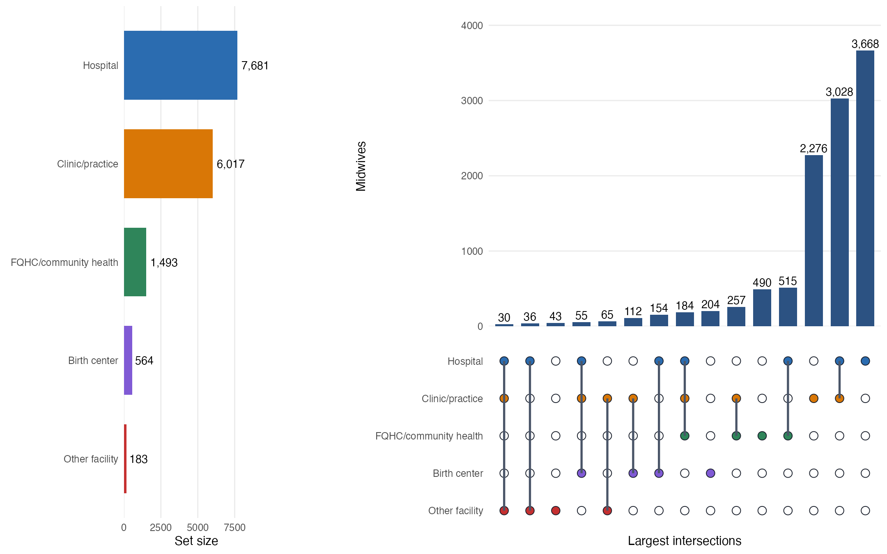

# Supplemental Table C. Work-setting intersections

Top 15 intersections among **12,171** midwives. Bars show intersection size; filled dots show which settings are included. Midwives with no classified setting are shown in the combination table but omitted from the intersection matrix.

