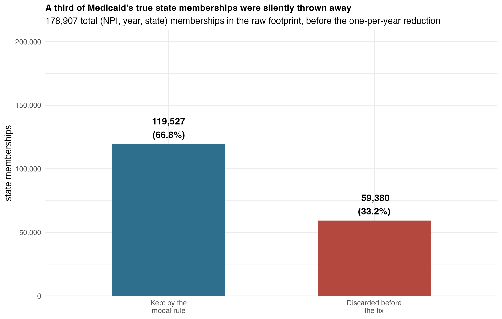
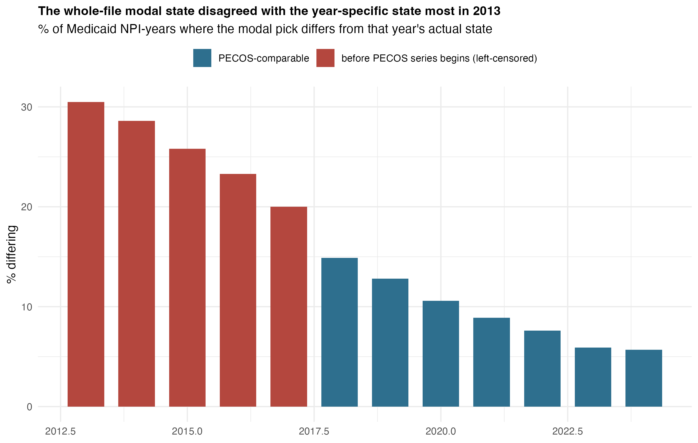
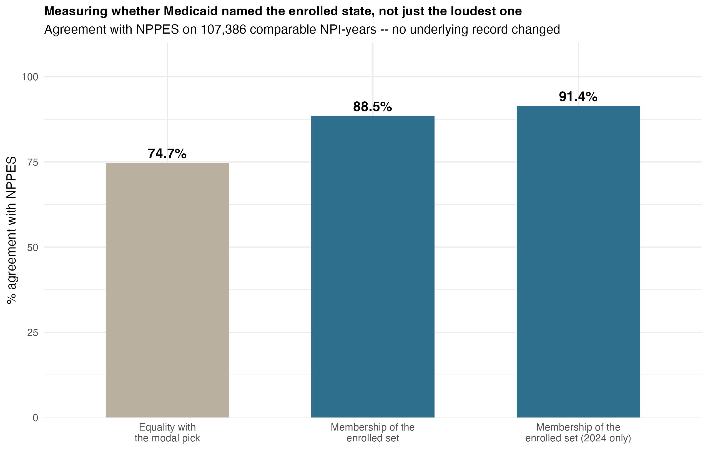
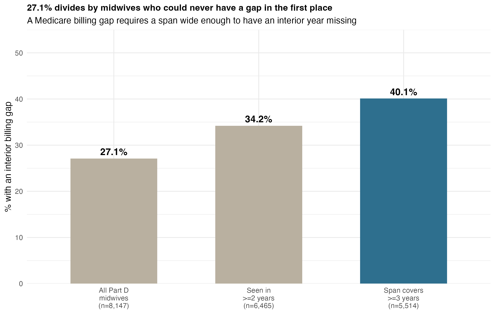
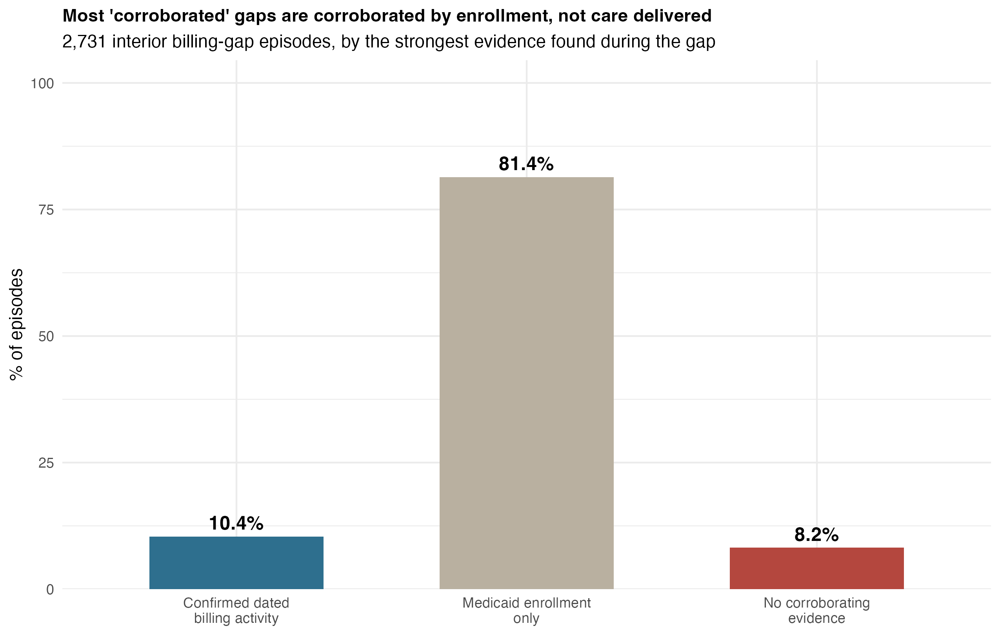

```{r setup, include=FALSE}
knitr::opts_chunk$set(collapse = TRUE, comment = "#>", echo = FALSE, eval = FALSE)
```

## The problem: a source that looked unusually unreliable

Among the independent sources this project cross-checks against each other, one stood out for
the wrong reasons. `medicaid_enrollment` had an odd-one-out rate of **0.166** -- five times the
next worst source -- and only **77.5%-77.6%** agreement under truth fusion. Reasonable
conclusions to draw from that: Medicaid enrollment data is noisy, under-maintained, or just not
a trustworthy witness for where a midwife actually practices.

All three of those conclusions turned out to be wrong, and the real cause was mundane:
**the comparison itself was broken.**

## Why the comparison was broken

A midwife enrolled in Medicaid across three states in the same year -- a real, common pattern
for providers near state lines or working telehealth -- was being reduced to **one** state by
picking the most frequent value and throwing the others away entirely. Not flagged, not kept
in a secondary field. Just gone.

```{r fig-discarded, eval=TRUE, echo=FALSE, out.width="100%"}

```

**59,380 of 178,907 real state memberships -- 33.2% -- never made it into any downstream
comparison.** Every subsequent test then asked the wrong question: not "did this other source
name a state Medicaid actually enrolled her in," but "did this other source happen to match the
*one* state Medicaid's reduction rule arbitrarily kept." A midwife enrolled in CO, NM, and AZ,
reduced to AZ, was scored as *disagreeing* with a source that correctly said CO.

```{r fig-yearly, eval=TRUE, echo=FALSE, out.width="100%"}

```

The damage wasn't evenly spread. Multi-state enrollment has grown steadily -- from 19.4% of
NPI-years in 2013 to 41% in 2024 -- so the modal-pick reduction threw away an increasing share
of real information every year the comparison ran.

## The fix: ask the right question

The fix doesn't touch a single underlying record. It asks a different question of the same
data: not "does this source equal Medicaid's one arbitrary pick," but "does this source name a
state Medicaid actually enrolled her in, among however many she was enrolled in that year."

```{r fig-fix, eval=TRUE, echo=FALSE, out.width="100%"}

```

**Agreement with NPPES moves from 74.7% to 88.5%** on the same 107,386 comparable NPI-years --
**91.4% in 2024 alone**. That's **14,815 NPI-years newly scored as agreeing**, recovered purely
by asking a question the data could actually answer.

**What this does not show**: 88.5% agreement means the two sources are *consistent* under a
fair comparison. It does not mean either one names the midwife's true practice location --
a midwife can be legitimately, correctly enrolled in Medicaid in a state she never sees a
patient in.

## A second thread: did Medicare billing gaps mean midwives left the field?

The same reconstruction effort also recovered five more years of PECOS enrollment history
(16 previously unread monthly extracts, 127,372 rows, back to **August 2016 -- five years
before the existing PECOS series began**) and the full 2013-2024 Medicare Part D claims series
(up from a 2013-2021 cut that was silently missing the state field). That longer run surfaced a
second, unrelated question: Medicare billing records show **27.1% of midwives with an apparent
gap year.** Did they leave practice?

```{r fig-denominator, eval=TRUE, echo=FALSE, out.width="100%"}

```

Same lesson, different dataset: **27.1% divides by every Part D midwife, including the 1,682
seen in exactly one year, who structurally cannot have an interior gap at all.** Restricting to
midwives whose career span is wide enough to show one -- three or more calendar years -- the
rate is **40.1% (2,209 of 5,514).** Not an error to retract this time, just the honest number
once the denominator actually matches the question being asked.

And the registry-exit theory doesn't hold up either: of 396 dated NPI deactivations in this
cohort, **zero** fall inside a billing gap.

```{r fig-corroboration, eval=TRUE, echo=FALSE, out.width="100%"}

```

Of the 2,731 gap episodes, **81.4% have Medicaid enrollment as their only corroborating
evidence during the gap** -- and enrollment is administrative presence, not care delivered. Only
**10.4% have confirmed dated billing activity**, and across multi-year gaps, confirmed billing
covers *every* missing year in just **2.1%** of episodes. An earlier draft of this analysis
reported 90-93% "corroboration" by counting enrollment as if it were activity; that number was
corrected, not published.

## Where this stands -- not everything is done

This work is explicitly **not complete**, and says so in its own tracking document
(`docs/spec-completion-matrix.md`): 5 of 14 planned sections are done, 4 partial, 5 not started.
Worth knowing before building on it:

- **Part B and Part D claims are still counted as two independent votes** despite sharing one
  underlying claims lineage -- 100% agreement on 13,745 NPI-years, which this work's own PPEF
  recovery *grew* rather than shrank. `attribute_claims_collapse_lineage()` exists and is not
  yet applied here.
- **NPPES snapshots are 6.0-19.1 months apart** (median 12.0), so every year-over-year rate in
  this repo assumes a clean annual period that doesn't actually exist.
- A validator for source-year assumptions, `assert_source_year()`, is implemented and tested
  but not yet called by any producer script.
- DAC's 2017-2025 extract sits in the warehouse, unused -- its producer currently aborts on five
  missing NBER files before it reaches the code that would read it.

## Where to look next

- `docs/longitudinal-reconstruction-changelog.md` -- every correction, with the withdrawn number
  printed beside the corrected one.
- `docs/spec-completion-matrix.md` -- section-by-section status against the originating
  specification, naming the test that covers each DONE row.
- `extract_medicaid_enrollment_state_by_year.R`, `audit_medicaid_set_membership.R` -- the fix.
- `audit_billing_gaps_vs_registry_status.R`, `audit_billing_gap_mechanisms.R`,
  `audit_billing_gap_headline_figures.R` -- the billing-gap analysis.
