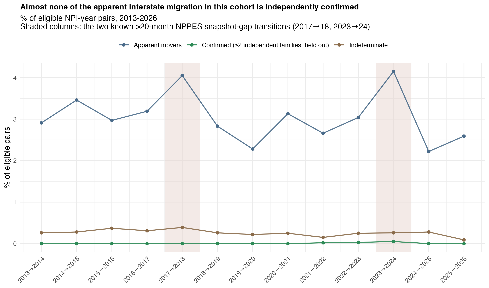
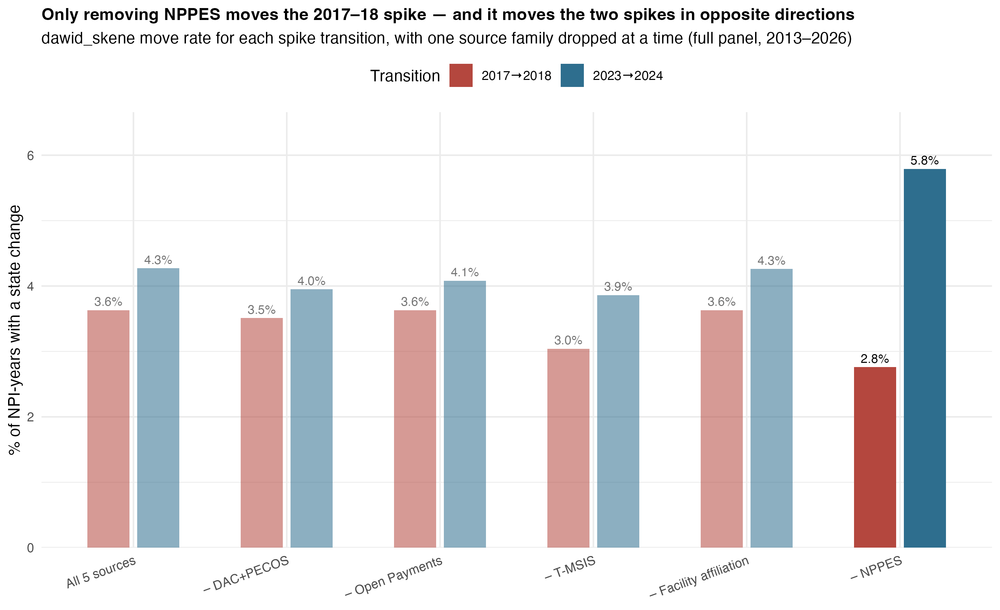
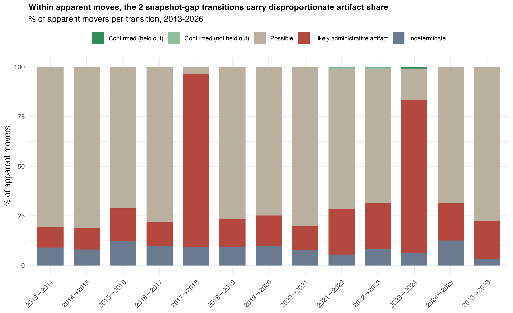
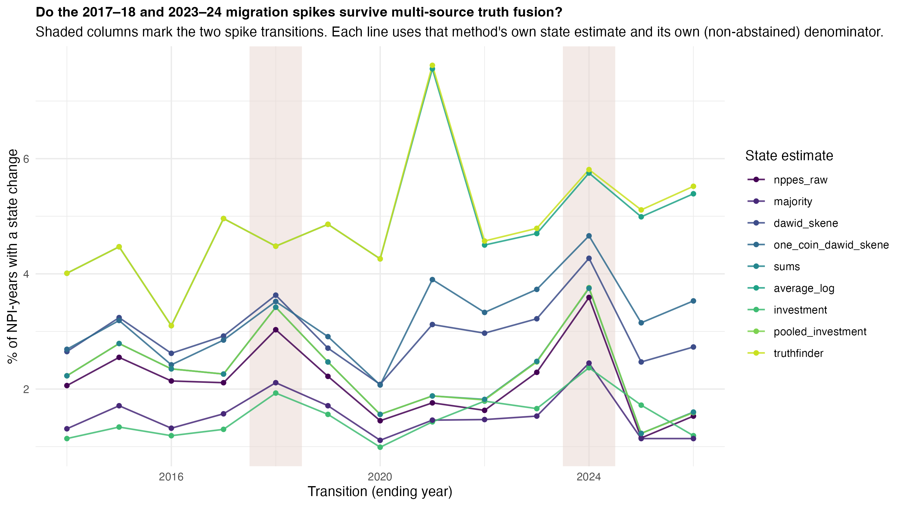
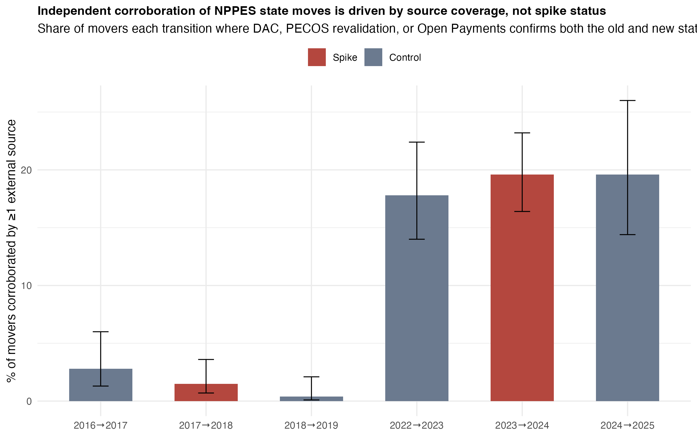

```{r setup, include=FALSE}
knitr::opts_chunk$set(collapse = TRUE, comment = "#>", echo = FALSE, eval = FALSE)
```

## The problem: two spikes nobody asked for

Plot every midwife's state in NPPES, year over year, and two things jump out immediately:
a sharp rise in apparent interstate moves between 2017 and 2018, and another between 2023 and
2024. Everywhere else, the year-over-year move rate sits in a quiet, boring band.

```{r fig-trends, eval=TRUE, echo=FALSE, out.width="100%"}

```

That is a genuinely interesting finding -- if it's real. A state suddenly gaining or losing
maternity-care workforce is the kind of thing a health-policy office would want to know about.
But NPPES is a self-reported directory. Providers update it when they feel like it, not on a
fixed clock. A spike could just as easily be two cohorts of midwives who happened to get around
to updating their listing in the same calendar year, years after they actually moved -- or never
moved at all.

**The stakes of getting this wrong**: treat an artifact as a real migration wave and you've
built a policy narrative -- "providers are fleeing state X" -- on nothing but directory lag.

## Why the obvious fix doesn't work

The obvious fix is: check whether another database agrees. If PECOS also shows the move,
that's corroboration, right?

Not quite. DAC and PECOS are not independent databases -- DAC is *generated from* PECOS
enrollment data. Two sources agreeing when one is derived from the other proves nothing except
that the derivation worked. This project treats that distinction as a hard rule, not a nuance:
**agreement between sources that share upstream lineage is never counted as independent
confirmation.**

The harder problem showed up when we tried to score it automatically: a model that defines "is
this move corroborated?" using the *same fused prediction* the move was detected from is
circular by construction. Of course the evidence agrees with itself.

## The fix: five sources, one honest scorecard

Every apparent move -- `(NPI, year_from, year_to)` where the fused best-estimate state changes
-- gets checked against four independent-enough witnesses: DAC+PECOS (merged into one vote,
since they share lineage), Open Payments, T-MSIS Medicaid enrollment, and hospital/facility
affiliation. Each witness is asked a narrow question for both the origin year and the
destination year: does it directly show this NPI at this state, with no inference and no
filling in gaps?

The corroboration test that actually resolves the circularity: a move only counts as
**Confirmed** if it survives being re-scored with each supporting source's family *removed
entirely* and refit from scratch -- the same leave-one-out machinery already built to test
whether the spike is an NPPES artifact, reused rather than reinvented.

```{r fig-sensitivity, eval=TRUE, echo=FALSE, out.width="100%"}

```

That figure alone answers a lot: pull NPPES out of the fusion and the 2017-18 and 2023-24
spikes mostly disappear. NPPES is the dominant driver of both, which is exactly why "NPPES says
so" cannot also be the test that confirms it.

## What came out of the full run

Across the whole cohort panel (2013-2026, 13 year-over-year transitions), the classifier found
**161,547 eligible NPI-year pairs**. The overwhelming majority -- **156,684 (97.0%)** -- are
stable: same state, no story. Of the **4,592 apparent moves (2.84%)**, here's where they landed:

```{r fig-composition, eval=TRUE, echo=FALSE, out.width="100%"}

```

| Classification | n | % of apparent movers |
|---|---|---|
| Confirmed | 7 | 0.2% |
| Confirmed (not held-out) | 7 | 0.2% |
| Possible | 2,957 | 64.4% |
| Likely administrative artifact | 1,488 | 32.4% |
| Indeterminate | 133 | 2.9% |

Read that again: **7 out of 4,592.** Under a rule that genuinely refuses to let a source
corroborate itself, almost nothing clears the bar for "independently confirmed." That is not a
failure of the classifier -- it is the classifier doing exactly what it was built to do, which
is refuse to manufacture confidence that isn't there.

## The benefit: a real yardstick for "hard to verify"

The number that makes this concrete: take the **156,684 pairs that never moved at all** and
run the identical ≥2-independent-family test on them. If the bar were easy to clear, stable
pairs and movers should clear it at similar rates.

They don't. **13.33% of stable pairs** meet the bar, versus **0.3% of movers** -- roughly
**44 times harder** to independently verify a move than to verify someone stayed put. That
asymmetry is the finding: it's not that movers are lying, it's that the administrative record
is built to notice *presence*, not *transitions*.

```{r fig-method, eval=TRUE, echo=FALSE, out.width="100%"}

```

```{r fig-corroboration, eval=TRUE, echo=FALSE, out.width="100%"}

```

And the sub-annual digging into the two named spikes tells a cleaner story than the top-level
numbers alone: NPPES is sensitive to source choice in 4 of 5 comparisons (9.49% of records
change state when NPPES is swapped for any other family's estimate), while every other source
moves by 0.04%-1.07% under the same swap. **2020-2021 is the single most source-sensitive
transition for 3 of the 5 source families** -- not a coincidence with the broader pandemic-era
data disruption, but not proof of a real migration wave either.

## What this doesn't tell you

- **"Possible" is not "probably fake."** 64.4% of apparent movers simply have no second
  independent source with a direct observation for both years -- silence, not contradiction.
- **"Likely administrative artifact" leans on two known structural facts**: the 2017-18 and
  2023-24 transitions both straddle a >=20-month gap in NPPES's own snapshot cadence. A move
  landing in one of those gaps with zero support and zero contradiction is flagged as the
  *weakest* kind of artifact call -- a mechanical fact about the transition, not a specific
  finding about that NPI.
- **The 44x figure has its own caveat**: the rate at which stable pairs clear the ≥2-family bar
  jumps from ~5-8% to ~24-25% exactly where PECOS's monthly data coverage happens to get denser,
  in 2021-2022 -- for movers and stable pairs alike. Some of that swing is measurement density,
  not a changing world.

## Where to look next

- `docs/TECHNICAL_APPENDIX_MIGRATION_MOVE_CLASSIFICATION.md` -- full rule definitions, all 7
  rule IDs, the 20 adversarial "saboteur" test cases that pressure-test the classifier
  specifically for the failure modes a model like this is prone to (fake independence via
  shared lineage, NPPES self-corroboration, rule-evaluation-order exploits).
- `classify_migration_moves_full_panel.R` -- the classifier itself.
- `tests/test_migration_move_classification.R` -- 40 assertions, one per rule and saboteur case.
- The person-level evidence timeline for individual example NPIs lives in `qa/` only (real NPIs,
  real per-source claims) and is deliberately never published.
